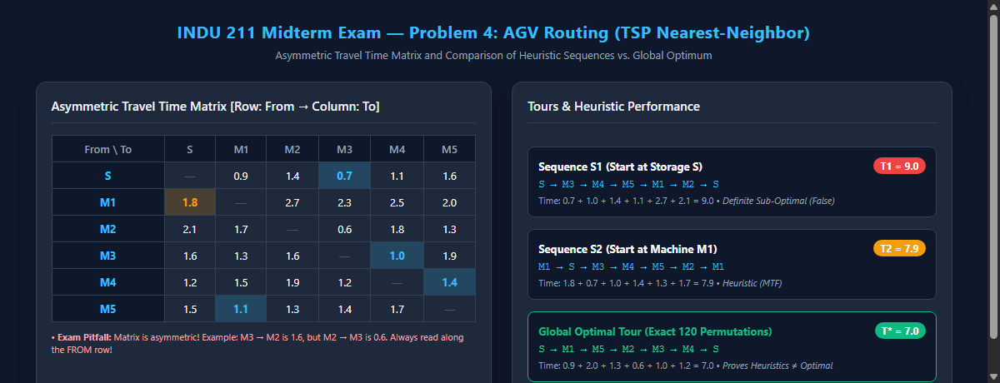

# Concordia University · Gina Cody School of Engineering
## Department of Mechanical, Industrial and Aerospace Engineering
# INDU 211: Introduction to Production and Manufacturing Systems
### Official Midterm Examination Master Study Guide & Complete Solved Paper
**Exam Session**: Fall 2025 (Paper A) · **Duration**: 75 Minutes (Closed Book) · **Total Value**: 50 Marks

---

> [!IMPORTANT]
> **Curriculum Alignment**: This master study guide and examination solution compendium is directly grounded in the official Concordia University INDU 211 curriculum (Chapters 1 to 5). It provides line-by-line mathematical proofs, complete option-by-option diagnostic eliminations, teacher marking keys, high-resolution visual engineering diagrams, and an exhaustive post-mortem of frequent exam traps.

---

## Table of Contents
1. [Executive Blueprint & Exam Structure](#1-executive-blueprint--exam-structure)
2. [Diagnostic Scorecard & Common Failure Modes](#2-diagnostic-scorecard--common-failure-modes)
3. [Problem 1: Core Multiple Choice (12 Marks)](#3-problem-1-core-multiple-choice-12-marks)
   - [Q1: Nature of Science vs. Engineering Practice](#question-1-nature-of-science-vs-engineering-practice)
   - [Q2: Legal Definition of Engineering Practice](#question-2-legal-definition-of-engineering-practice)
   - [Q3: Canadian Professional Engineering Regulation](#question-3-canadian-professional-engineering-regulation)
   - [Q4: Scope of Engineering vs. Pure Science](#question-4-scope-of-engineering-vs-pure-science-trap-question)
   - [Q5: Core Definition and Mission of Industrial Engineering](#question-5-core-definition-and-mission-of-industrial-engineering)
   - [Q6: Classification of Human Activity Systems](#question-6-classification-of-human-activity-systems)
   - [Q7: Single-Product Break-Even Pricing Calculation](#question-7-single-product-break-even-pricing-calculation)
   - [Q8: Multi-Process Selection via Crossover Break-Even Analysis](#question-8-multi-process-selection-via-crossover-break-even-analysis)
   - [Q9: Concurrent Engineering Principles and Advantages](#question-9-concurrent-engineering-principles-and-advantages)
   - [Q10: The Three Classical Facility Layout Classifications](#question-10-the-three-classical-facility-layout-classifications)
   - [Q11: Product vs. Process Layout Operator Skill Trade-offs](#question-11-product-vs-process-layout-operator-skill-trade-offs)
   - [Q12: Automation Drivers in Material Handling Systems](#question-12-automation-drivers-in-material-handling-systems)
4. [Problem 2: Multi-Level Bill of Materials (BOM) Explosion (10 Marks)](#4-problem-2-multi-level-bill-of-materials-bom-explosion-10-marks)
   - [BOM Architecture & Visual Schematic](#bom-architecture--visual-schematic)
   - [Subassembly Weekly Demand Derivation](#subassembly-weekly-demand-derivation)
   - [Raw Component Explosion & Cross-Product Aggregation](#raw-component-explosion--cross-product-aggregation)
   - [Complete Master Solution Table](#complete-master-solution-table)
   - [Marking Diagnostic: Why Students Score 0/10](#marking-diagnostic-why-students-score-010)
5. [Problem 3: Transportation Linear Programming & Heuristics (16 Marks)](#5-problem-3-transportation-linear-programming--heuristics-16-marks)
   - [Transportation Tableau & Balanced Supply/Demand Check](#transportation-tableau--balanced-supplydemand-check)
   - [Solution S1: Northwest Corner / Top-Down Left-Right Method](#solution-s1-northwest-corner--top-down-left-right-method)
   - [Solution S2: Lowest Cost First / Minimum Cell Cost Heuristic](#solution-s2-lowest-cost-first--minimum-cell-cost-heuristic)
   - [Optimality Analysis & True/False/MTF Logic](#optimality-analysis--truefalsemtf-logic)
   - [Advanced MODI (u-v) Verification of True Global Optimum](#advanced-modi-u-v-verification-of-true-global-optimum)
6. [Problem 4: Traveling Salesperson Problem (TSP) & AGV Routing (12 Marks)](#6-problem-4-traveling-salesperson-problem-tsp--agv-routing-12-marks)
   - [Asymmetric Travel Time Matrix Analysis](#asymmetric-travel-time-matrix-analysis)
   - [Sequence S1: Nearest-Neighbor Heuristic from Storage S](#sequence-s1-nearest-neighbor-heuristic-from-storage-s)
   - [Sequence S2: Nearest-Neighbor Heuristic from Machine M1](#sequence-s2-nearest-neighbor-heuristic-from-machine-m1)
   - [Heuristic Sub-Optimality & True/False/MTF Evaluation](#heuristic-sub-optimality--truefalsemtf-evaluation)
   - [Multi-Start Nearest Neighbor Heuristic Limits (Question 4.4)](#multi-start-nearest-neighbor-heuristic-limits-question-44)
   - [Exhaustive Combinatorial Verification (Global Minimum Proof)](#exhaustive-combinatorial-verification-global-minimum-proof)
7. [High-Yield Midterm Formula Sheet & Exam Rules of Thumb](#7-high-yield-midterm-formula-sheet--exam-rules-of-thumb)

---

## 1. Executive Blueprint & Exam Structure

| Component | Syllabus Scope | Questions | Total Value | Exam Weight |
|---|---|---|---|---|
| **Problem 1** | Chapters 1, 2, 3, 4, 5 | 12 Multiple Choice Questions | 12 Marks | 24% |
| **Problem 2** | Chapter 3 (Product Design & BOM) | Multi-Level BOM Explosion Table | 10 Marks | 20% |
| **Problem 3** | Chapter 4 (Facility Location & Logistics) | Transportation Table (S1, S2, Optimality) | 16 Marks | 32% |
| **Problem 4** | Chapter 5 (Material Handling & TSP) | AGV Routing Sequences & Heuristics | 12 Marks | 24% |
| **Total** | **Comprehensive Midterm 1 Coverage** | **All 4 Problem Modules** | **50 Marks** | **100%** |

### Format & Permitted Tools
- **Duration**: 75 Minutes (1 hour 15 minutes).
- **Environment**: Closed Book, Closed Notes.
- **Allowed Calculator**: Standard ENCS faculty-approved non-programmable calculator with sticker (e.g., Casio fx-300MS, Sharp EL-531).
- **Format**: All answers must be written directly in the designated spaces on the official paper. No external scrap booklets are graded.

---

## 2. Diagnostic Scorecard & Common Failure Modes

The INDU 211 Midterm Examination is designed with specific discriminators that separate superficial memorization from rigorous systems engineering thinking. The table below analyzes the specific traps where students historically surrender up to 30 marks:

```
+----------------------------------------------------------------------------------------------------+
|                                    HISTORIC EXAM FAILURE MODES                                    |
+-------------------+-------+-------------------------------+----------------------------------------+
| Question Module   | Loss  | Superficial / Erroneous Move   | Rigorous Engineering Method            |
+-------------------+-------+-------------------------------+----------------------------------------+
| Q4 (Ethics/Scope) | -1 M  | Marking "Protecting economic  | Science creates new theories;          |
|                   |       | interests" as non-engineering | engineering applies science to design  |
+-------------------+-------+-------------------------------+----------------------------------------+
| Q7 (Break-Even)   | -1 M  | Guessing $50/unit without     | Apply algebraic equilibrium:           |
|                   |       | dividing fixed costs by units | P = VC + (FC / Q_BE) = 30 + 30 = $60   |
+-------------------+-------+-------------------------------+----------------------------------------+
| Q8 (Crossover)    | -1 M  | Picking Process B purely for  | Calculate total cost at Q = 5,200:     |
|                   |       | lower variable cost ($5 < $10)| TC_A = $102k < TC_B = $106k (Choose A) |
+-------------------+-------+-------------------------------+----------------------------------------+
| Prob 2 (BOM Tree) | -10 M | Summing child component counts| Top-down level explosion: multiply     |
|                   |       | into subassembly table slots  | parent demand by branch requirement    |
+-------------------+-------+-------------------------------+----------------------------------------+
| Prob 3.1 (Cost S1)| -2 M  | Misinterpreting printed       | S1 is pure NW-Corner: multiply printed |
|                   |       | allocation cells in table S1  | basic cell units by unit shipping cost |
+-------------------+-------+-------------------------------+----------------------------------------+
| Prob 3.4 (T/F/MTF)| -6 M  | Calling heuristic solution S2 | Heuristics yield feasible basic paths; |
|                   |       | "False" or "True" for optimal | optimality without MODI is MTF         |
+-------------------+-------+-------------------------------+----------------------------------------+
| Prob 4.1 (TSP S1) | -3 M  | Reading column costs instead  | Matrix is asymmetric: must read row    |
|                   |       | of row costs (0.6 vs 1.6)     | costs strictly from current vertex     |
+-------------------+-------+-------------------------------+----------------------------------------+
```

---

## 3. Problem 1: Core Multiple Choice (12 Marks)

### Question 1: Nature of Science vs. Engineering Practice
**Problem Statement**:
> Which of the following statements is correct?
> a. Science is based purely on imagination and creativity rather than observation and experimentation.
> b. Results generated from computer modeling are sufficiently realistic to guide engineering practice.
> c. Scientific theories can be validated through physical experiments, and these theories may be applied to develop technologies that solve practical problems.
> d. None of the above.

- **Correct Answer**: **c**
- **Syllabus Link**: Chapter 1 (Foundations of Engineering & Technology).
- **Pedagogical Rationale**:
  - Statement (a) is false: While creativity plays a role in hypothesis generation, science is fundamentally rooted in the scientific method—empirical observation, systematic hypothesis testing, and controlled experimentation.
  - Statement (b) is false: Computer models are idealized mathematical approximations. In professional engineering practice, computational results must be validated against physical reality and safety codes; models alone are never assumed to be fully realistic without empirical verification.
  - Statement (c) is the definitive epistemology of modern applied science and engineering: physical experiments validate scientific theories, which engineers subsequently synthesize into tangible technologies to solve societal and industrial problems.
- **Why Wrong**:
  - `a`: Ignores empirical validation.
  - `b`: Over-relies on simulations without physical validation.
  - `d`: Statement (c) is completely accurate.

---

### Question 2: Legal Definition of Engineering Practice
**Problem Statement**:
> Which of the following activities falls under the “practice of engineering”?
> a. Designing a bridge using structural analysis principles
> b. Advising on safe material use for a factory process
> c. Supervising the construction of a power plant
> d. All of the above

- **Correct Answer**: **d**
- **Syllabus Link**: Chapter 1 & 2 (The Engineering Profession, Codes of Ethics & Acts).
- **Pedagogical Rationale**:
  - Under provincial engineering acts across Canada (e.g., Quebec Engineers Act / OIQ, Ontario Professional Engineers Act / PEO), the practice of engineering encompasses any act of planning, designing, composing, evaluating, advising, reporting, directing, or supervising where the safeguarding of life, health, property, economic interests, public welfare, or the environment requires the application of engineering principles.
  - Designing a bridge (a), advising on chemical/materials safety (b), and supervising industrial construction works (c) all fall under this statutory mandate.
- **Why Wrong**:
  - `a`, `b`, `c`: Each is a valid engineering activity, making "All of the above" the comprehensive correct response.

---

### Question 3: Canadian Professional Engineering Regulation
**Problem Statement**:
> In Canada, engineering is a profession and:
> a. Can be carried out by scientists who hold a Ph.D. in a scientific field.
> b. Is regulated by provincial associations of professional engineers.
> c. Is open to anyone with a high school diploma and practical skills.
> d. Is governed by the United Nations Commission on Science and Technology for Development (UNCSTD).
> e. None of the above.

- **Correct Answer**: **b**
- **Syllabus Link**: Chapter 2 (Professional Licensure & Statutory Governance in Canada).
- **Pedagogical Rationale**:
  - In Canada, under the Constitution Act, professional licensure and regulation fall under provincial/territorial jurisdiction.
  - Engineering is a self-regulated closed profession governed by 12 constituent provincial and territorial associations (e.g., Ordre des ingénieurs du Québec - OIQ in Quebec; Professional Engineers Ontario - PEO in Ontario).
  - Holding a Ph.D. in science (a) or having practical skills (c) does not legally grant the right to practice engineering or use the title "Engineer" without an active license issued by the provincial regulator.
- **Why Wrong**:
  - `a`: A doctorate in physics or chemistry does not confer an engineering license.
  - `c`: Engineering requires accredited education (CEAB), exams, and licensed peer review.
  - `d`: UNCSTD is an international advisory committee, not a regulatory licensing body.

---

### Question 4: Scope of Engineering vs. Pure Science (Trap Question)
**Problem Statement**:
> Which of the following is NOT necessarily part of the engineering profession as defined in its practice?
> a. Performing scientific experiments to establish new theories
> b. Safeguarding life and health
> c. Protecting economic interests and property
> d. Ensuring public welfare and environmental safety

- **Correct Answer**: **a**
- **Syllabus Link**: Chapter 1 (Distinguishing Pure Science from Applied Engineering).
- **Pedagogical Rationale**:
  - **The Classic Exam Trap**: Many students circle option (c) under the mistaken impression that engineers do not care about economic interests. In reality, the engineer's statutory code of ethics explicitly binds the professional to safeguard life, health, property, economic viability, and public welfare.
  - Option (a)—*performing scientific experiments to establish new theories*—is the fundamental charter of **pure science** (e.g., theoretical physics, fundamental chemistry), not engineering. Engineers apply existing physical laws and scientific theories to solve practical problems and design cost-effective systems. An engineer may perform tests to characterize materials or validate a design, but generating fundamental scientific theories is not a requirement of engineering practice.
- **Why Wrong**:
  - `b`, `c`, `d`: Are core legal and ethical obligations of every practicing professional engineer.

---

### Question 5: Core Definition and Mission of Industrial Engineering
**Problem Statement**:
> Industrial Engineering, as a discipline, mainly deals with issues related to:
> a. Software and App development for social networking among engineers
> b. Discovering certain chemical compounds for effective treatments of workplace related sickness
> c. Analyzing, designing, and evaluating integrated systems of people, equipment and information
> d. Developing microelectronic chips for faster and more reliable communication
> e. None of the above

- **Correct Answer**: **c**
- **Syllabus Link**: Chapter 2 (IISE Definition & Philosophy of Industrial Engineering).
- **Pedagogical Rationale**:
  - The official definition codified by the Institute of Industrial and Systems Engineers (IISE) states:
    $$\text{IE is concerned with the design, improvement, and installation of integrated systems of people, materials, information, equipment, and energy.}$$
  - It draws upon specialized knowledge in the mathematical, physical, and social sciences together with the principles of engineering analysis and design to specify, predict, and evaluate the results obtained from such systems.
- **Why Wrong**:
  - `a`: Computer Science / Software Engineering.
  - `b`: Pharmacology / Medicine / Toxicology.
  - `d`: Electrical / Computer Engineering.

---

### Question 6: Classification of Human Activity Systems
**Problem Statement**:
> Which of the following is an example of a human activity system considered by IE?
> a. Forecasting procedures
> b. Physical workplace layout, material handling, safety procedures
> c. Production scheduling
> d. Budgeting and incentive plans

- **Correct Answer**: **b**
- **Syllabus Link**: Chapter 2 (Systems Concepts: Human Activity Systems vs. Management Systems).
- **Pedagogical Rationale**:
  - In systems engineering taxonomy:
    - *Forecasting procedures* (a) are **information and mathematical modeling systems**.
    - *Production scheduling* (c) is a **production planning and control system**.
    - *Budgeting and incentive plans* (d) are **financial and managerial incentive systems**.
    - *Physical workplace layout, material handling, and occupational safety* (b) directly involve the physical, anatomical, and biomechanical interaction of human workers with physical facilities, equipment, and environments (ergonomics and human factors engineering).
- **Why Wrong**:
  - `a`, `c`, `d`: These represent administrative, numerical, or managerial control loops rather than physical human activity systems.

---

### Question 7: Single-Product Break-Even Pricing Calculation
**Problem Statement**:
> A company produces gadgets with a fixed cost of \$15,000 and a variable cost of \$30/unit. If the break-even quantity is 500 units, what should be the selling price per unit so the production remains profitable?
> a. \$45/unit
> b. \$50/unit
> c. \$55/unit
> d. \$60/unit

- **Correct Answer**: **d**
- **Syllabus Link**: Chapter 3 (Cost-Volume-Profit Analysis & Break-Even Engineering).
- **Step-by-Step Mathematical Derivation**:
  1. The break-even quantity $Q_{BE}$ is defined where Total Revenue equals Total Cost:
     $$TR = TC \implies P \cdot Q_{BE} = FC + VC \cdot Q_{BE}$$
  2. Rearranging to isolate unit selling price $P$:
     $$P \cdot Q_{BE} - VC \cdot Q_{BE} = FC$$
     $$Q_{BE} (P - VC) = FC \implies P - VC = \frac{FC}{Q_{BE}}$$
     $$P = VC + \frac{FC}{Q_{BE}}$$
  3. Substituting the given parameters ($FC = \$15,000$, $VC = \$30/\text{unit}$, $Q_{BE} = 500\text{ units}$):
     $$P = 30 + \frac{15,000}{500} = 30 + 30 = \mathbf{\$60/\text{unit}}$$
  4. **Verification**:
     - Total Revenue at 500 units: $TR = 60 \times 500 = \$30,000$.
     - Total Cost at 500 units: $TC = 15,000 + 30 \times 500 = 15,000 + 15,000 = \$30,000$.
     - Net Profit: $\pi = TR - TC = \$0$ (exact break-even threshold).
     - For production to yield positive operating income ($\pi > 0$), selling price must be at least \$60/unit.
- **Why Wrong**:
  - `a` (\$45): $TR = 45 \times 500 = \$22,500 < \$30,000$ (Loss of \$7,500).
  - `b` (\$50): $TR = 50 \times 500 = \$25,000 < \$30,000$ (Loss of \$5,000; common student guess).
  - `c` (\$55): $TR = 55 \times 500 = \$27,500 < \$30,000$ (Loss of \$2,500).

---

### Question 8: Multi-Process Selection via Crossover Break-Even Analysis
**Problem Statement**:
> Based on the data provided in the table below, if projected annual demand is 5,200 units, which process would be preferred based on break-even analysis?
>
> | Process | Fixed Cost ($FC$) | Variable Cost ($VC$) |
> |---|---|---|
> | **Process A** | \$50,000 | \$10 / unit |
> | **Process B** | \$80,000 | \$5 / unit |
>
> a. Process A, because it reaches break-even earlier
> b. Process B, because it has lower variable cost
> c. Either process, because both are above break-even
> d. Cannot decide

- **Correct Answer**: **a**
- **Syllabus Link**: Chapter 3 (Process Selection, Fixed vs. Variable Cost Trade-offs & Crossover Volume).
- **Step-by-Step Mathematical Derivation**:
  1. Calculate the total cost function for each manufacturing process at demand $Q$:
     $$TC_A(Q) = FC_A + VC_A \cdot Q = 50,000 + 10Q$$
     $$TC_B(Q) = FC_B + VC_B \cdot Q = 80,000 + 5Q$$
  2. Compute the **indifference / crossover volume** $Q^*$ where both processes incur equal total cost:
     $$TC_A(Q^*) = TC_B(Q^*) \implies 50,000 + 10Q^* = 80,000 + 5Q^*$$
     $$5Q^* = 30,000 \implies Q^* = \frac{30,000}{5} = \mathbf{6,000\text{ units}}$$
  3. **Economic Decision Rule**:
     - For $Q < 6,000$ units: Process A has **lower total cost** because its lower fixed cost dominates.
     - For $Q > 6,000$ units: Process B has **lower total cost** because its lower variable cost amortizes the higher fixed investment.
  4. Evaluate at the projected annual demand of $Q = 5,200\text{ units}$:
     $$TC_A(5,200) = 50,000 + 10(5,200) = 50,000 + 52,000 = \mathbf{\$102,000}$$
     $$TC_B(5,200) = 80,000 + 5(5,200) = 80,000 + 26,000 = \mathbf{\$106,000}$$
  5. Selecting Process A yields a direct economic saving of:
     $$\Delta TC = \$106,000 - \$102,000 = \mathbf{\$4,000\text{ per year}}$$
- **Common Exam Trap**: Students reflexively select (b) because \$5 is less than \$10. However, choosing Process B at 5,200 units forces the firm to absorb \$30,000 in excess fixed overhead that cannot be recovered over only 5,200 units.

---

### Question 9: Concurrent Engineering Principles and Advantages
**Problem Statement**:
> Which of the following is a key advantage of concurrent engineering?
> a. Longer product development cycle
> b. Increased separation of functional teams
> c. Faster time to market and better product quality
> d. Reduced emphasis on environmental concerns

- **Correct Answer**: **c**
- **Syllabus Link**: Chapter 3 (Concurrent Engineering vs. Traditional "Over-the-Wall" Sequential Design).
- **Pedagogical Rationale**:
  - Traditional sequential engineering passes designs sequentially from Marketing $\rightarrow$ R&D $\rightarrow$ Manufacturing $\rightarrow$ Quality Control with minimal cross-communication, resulting in late engineering change orders (ECOs), expensive tooling reworks, and prolonged lead times.
  - Concurrent engineering (simultaneous engineering) brings cross-functional teams (design, manufacturing, procurement, quality, field service) together from day one.
  - Key benefits: **Faster time-to-market**, **lower total product lifecycle cost**, **fewer engineering changes**, and **higher initial quality**.
- **Why Wrong**:
  - `a`: The development cycle is shortened, not lengthened.
  - `b`: Concurrent engineering eliminates functional silos; it does not increase separation.
  - `d`: Design for Environment (DfE) and sustainability are integrated earlier.

---

### Question 10: The Three Classical Facility Layout Classifications
**Problem Statement**:
> The three basic types of facility layout in manufacturing systems are:
> a. Product layout, U-shaped layout, fixed layout
> b. Product layout, process layout, fixed layout
> c. Conveyor-based layout, AGV layout, cellular layout
> d. Optimal layout, sub-optimal layout, non-optimal layout
> e. none of the above

- **Correct Answer**: **b**
- **Syllabus Link**: Chapter 4 (Facilities Layout Principles & Material Flow Patterns).
- **Pedagogical Rationale**:
  - Industrial engineering formally classifies facility layouts into three classical archetypes based on product variety and production volume:
    1. **Product Layout (Line / Flow Shop)**: Arranged sequentially according to the operational processing steps of the product (high volume, low variety, e.g., automotive assembly line).
    2. **Process Layout (Functional / Job Shop)**: Similar machines and processes grouped into functional departments (low volume, high variety, e.g., custom machine shop).
    3. **Fixed-Position Layout (Project Layout)**: The product remains stationary due to extreme weight or bulk (e.g., shipbuilding, aircraft assembly, bridge construction), and workers, materials, and equipment move to the product.
- **Why Wrong**:
  - `a`: U-shaped is a specific geometric variant of a line/cellular layout, not a primary category.
  - `c`: Lists material handling transport mechanisms.
  - `d`: Nonsensical optimality descriptors.

---

### Question 11: Product vs. Process Layout Operator Skill Trade-offs
**Problem Statement**:
> Which layout usually requires little operator skill but demands high investment in machines?
> a. Process layout
> b. Product layout
> c. Fixed-position layout
> d. Cellular layout

- **Correct Answer**: **b**
- **Syllabus Link**: Chapter 4 (Economic & Labor Characteristics of Manufacturing Layouts).
- **Pedagogical Rationale**:
  - In a **Product Layout**, production tasks are divided into highly standardized, short-cycle, repetitive work elements along a progressive line. Operations are automated through dedicated, single-purpose machinery (high capital equipment investment), allowing operators to be trained rapidly with minimal initial craft skills.
  - In contrast, a **Process Layout** utilizes flexible, general-purpose machines that require highly skilled machinists and technicians to interpret blueprints, perform complex machine setups, and adapt to custom orders.
- **Why Wrong**:
  - `a`: High operator skill, lower dedicated machine investment.
  - `c`: High craftsman skill, mobile general-purpose equipment.
  - `d`: Moderate-to-high cross-trained multi-machine operator skill.

---

### Question 12: Automation Drivers in Material Handling Systems
**Problem Statement**:
> A company introduces a new automated material-handling system. This is most directly related to which reason?
> a. Changes in methods and equipment
> b. Changes in environmental requirements
> c. Morale problems
> d. Inefficient operations

- **Correct Answer**: **a**
- **Syllabus Link**: Chapter 5 (Material Handling Systems Modernization & Facility Redesign Drivers).
- **Pedagogical Rationale**:
  - In facility redesign and operations management, the introduction of automated material handling systems (e.g., Automated Guided Vehicles - AGVs, Automated Storage and Retrieval Systems - AS/RS, smart overhead monorails) represents a direct technological transition in **methods and equipment**.
  - While inefficient operations (d) may be a symptom that triggers an engineering review, the formal classification of the implementation itself falls under changes in production methods and physical handling equipment.
- **Why Wrong**:
  - `b`: Environmental/regulatory changes typically govern emissions, noise, or waste disposal.
  - `c`: Morale is a human resource / organizational behavior issue.
  - `d`: Inefficiency is an operational metric, whereas equipment replacement is a technological method change.

---

## 4. Problem 2: Multi-Level Bill of Materials (BOM) Explosion (10 Marks)

### Problem Statement & Given Data
A manufacturing company produces two optical devices: **Product 1 (P-1)** and **Product 2 (P-2)**. Each product is assembled from intermediate subassemblies (**S-1** to **S-5**) and raw components (**C-1** to **C-5**).
- **Weekly Demand for Product 1**: $D(P_1) = 10\text{ units / week}$.
- **Weekly Demand for Product 2**: $D(P_2) = 20\text{ units / week}$.

The number in parentheses above each box denotes the **parent-to-child usage multiplier** (the number of units needed to produce 1 unit of the item one level directly above it).

---

### BOM Architecture & Visual Schematic


*Figure 1: Official INDU 211 Midterm Bill of Materials (BOM) hierarchy for Product 1 ($P_1$) and Product 2 ($P_2$), showing intermediate subassembly levels ($S_1\dots S_5$) and raw component requirements ($C_1\dots C_5$).*

---

### Subassembly Weekly Demand Derivation

To determine the gross requirements of each intermediate subassembly, trace the branches originating from the end-item products:

1. **Subassembly S-1**:
   - Appears exclusively under Product 1: Usage multiplier = 2 units of $S_1$ per unit of $P_1$.
   $$\text{Gross Req}(S_1) = D(P_1) \times 2 = 10 \times 2 = \mathbf{20\text{ units}}$$

2. **Subassembly S-2**:
   - Appears exclusively under Product 1: Usage multiplier = 2 units of $S_2$ per unit of $P_1$.
   $$\text{Gross Req}(S_2) = D(P_1) \times 2 = 10 \times 2 = \mathbf{20\text{ units}}$$

3. **Subassembly S-3 (Common Subassembly)**:
   - Appears under **Product 1**: Usage multiplier = 3 units of $S_3$ per unit of $P_1$.
     $$\text{Req from } P_1 = 10 \times 3 = 30\text{ units}$$
   - Appears under **Product 2**: Usage multiplier = 2 units of $S_3$ per unit of $P_2$.
     $$\text{Req from } P_2 = 20 \times 2 = 40\text{ units}$$
   $$\text{Total Gross Req}(S_3) = 30 + 40 = \mathbf{70\text{ units}}$$

4. **Subassembly S-4**:
   - Appears exclusively under Product 2: Usage multiplier = 2 units of $S_4$ per unit of $P_2$.
   $$\text{Gross Req}(S_4) = D(P_2) \times 2 = 20 \times 2 = \mathbf{40\text{ units}}$$

5. **Subassembly S-5**:
   - Appears exclusively under Product 2: Usage multiplier = 3 units of $S_5$ per unit of $P_2$.
   $$\text{Gross Req}(S_5) = D(P_2) \times 3 = 20 \times 3 = \mathbf{60\text{ units}}$$

---

### Raw Component Explosion & Cross-Product Aggregation

Components are exploded downward from their immediate parent subassemblies. Every subassembly requirement established above must be multiplied by the child usage factor:

#### Component C-1:
$C_1$ is required across four separate subassemblies ($S_1, S_2, S_4, S_5$):
- From $S_1$: $20\text{ units of } S_1 \times 3\text{ units of } C_1 = 60\text{ units}$
- From $S_2$: $20\text{ units of } S_2 \times 2\text{ units of } C_1 = 40\text{ units}$
- From $S_4$: $40\text{ units of } S_4 \times 2\text{ units of } C_1 = 80\text{ units}$
- From $S_5$: $60\text{ units of } S_5 \times 2\text{ units of } C_1 = 120\text{ units}$
$$\text{Total Gross Req}(C_1) = 60 + 40 + 80 + 120 = \mathbf{300\text{ units}}$$

#### Component C-2:
$C_2$ appears under $S_1$ and under the $S_3$ branch of Product 1:
- From $S_1$: $20\text{ units of } S_1 \times 3\text{ units of } C_2 = 60\text{ units}$
- From $S_3$ in $P_1$: The 30 units of $S_3$ assembled for $P_1$ each require 2 units of $C_2$:
  $$30\text{ units of } S_3 \times 2\text{ units of } C_2 = 60\text{ units}$$
$$\text{Total Gross Req}(C_2) = 60 + 60 = \mathbf{120\text{ units}}$$

#### Component C-3:
$C_3$ appears under $S_1$ and $S_5$:
- From $S_1$: $20\text{ units of } S_1 \times 2\text{ units of } C_3 = 40\text{ units}$
- From $S_5$: $60\text{ units of } S_5 \times 2\text{ units of } C_3 = 120\text{ units}$
$$\text{Total Gross Req}(C_3) = 40 + 120 = \mathbf{160\text{ units}}$$

#### Component C-4:
$C_4$ appears under $S_2$ and $S_4$:
- From $S_2$: $20\text{ units of } S_2 \times 4\text{ units of } C_4 = 80\text{ units}$
- From $S_4$: $40\text{ units of } S_4 \times 3\text{ units of } C_4 = 120\text{ units}$
$$\text{Total Gross Req}(C_4) = 80 + 120 = \mathbf{200\text{ units}}$$

#### Component C-5:
$C_5$ appears under the $S_3$ branch of Product 2:
- From $S_3$ in $P_2$: The 40 units of $S_3$ assembled for $P_2$ each require 3 units of $C_5$:
  $$40\text{ units of } S_3 \times 3\text{ units of } C_5 = \mathbf{120\text{ units}}$$

---

### Complete Master Solution Table

| P-1 | P-2 | S-1 | S-2 | S-3 | S-4 | S-5 | C-1 | C-2 | C-3 | C-4 | C-5 |
|:---:|:---:|:---:|:---:|:---:|:---:|:---:|:---:|:---:|:---:|:---:|:---:|
| **10** | **20** | **20** | **20** | **70** | **40** | **60** | **300** | **120** | **160** | **200** | **120** |

*Note: In the official grading scheme, each correct cell in the table carries exactly 1 mark ($10\text{ cells} \times 1\text{ mark} = 10\text{ marks}$).*

---

### Marking Diagnostic: Why Students Score 0/10
In the student exam sample, every single cell from S-1 through C-5 was marked wrong (resulting in a devastating penalty of $-10$ marks). The student recorded:
- $S_1 = 160$, $S_2 = 120$, $S_3 = 60$, $S_4 = 200$, $S_5 = 240$
- $C_1 = 40$, $C_2 = 20$, $C_3 = 40$, $C_4 = 60$, $C_5 = 60$

**Root Cause Analysis**:
1. **Inverted Roll-up**: The student attempted to sum the lower-level component multipliers under a subassembly (e.g., under $S_1$: $3+3+2 = 8$), multiply by 10, and multiply by 2 to get 160, then placed that number into the *subassembly* cell!
2. **Failure to Recognize Hierarchy**: A Bill of Materials is an explosion process, not an inverted compression. Subassemblies at Level 1 depend *solely* on their parent end-item demand and their direct parent branch factor. Components at Level 2 then depend on the calculated subassembly quantities. Confusing levels guarantees a score of 0.

---

## 5. Problem 3: Transportation Linear Programming & Heuristics (16 Marks)

### Transportation Tableau & Balanced Supply/Demand Check
A manufacturing firm ships product containers from 3 factories ($F_1, F_2, F_3$) to 3 distribution warehouses ($W_1, W_2, W_3$). The unit transportation costs $c_{ij}$, factory supplies $a_i$, and warehouse demands $b_j$ are given:

$$\begin{array}{c|ccc|c}
\text{From \ To} & W_1 & W_2 & W_3 & \text{Supply } (a_i) \\
\hline
F_1 & 14 & 9 & 11 & \mathbf{25} \\
F_2 & 10 & 12 & 8 & \mathbf{30} \\
F_3 & 13 & 7 & 10 & \mathbf{25} \\
\hline
\text{Demand } (b_j) & \mathbf{20} & \mathbf{35} & \mathbf{25} & \sum = \mathbf{80}
\end{array}$$

$$\sum_{i=1}^3 a_i = 25 + 30 + 25 = 80 \quad \text{and} \quad \sum_{j=1}^3 b_j = 20 + 35 + 25 = 80$$
$$\sum a_i = \sum b_j = 80 \implies \mathbf{Balanced\ Transportation\ Problem}$$

---


*Figure 2: Comprehensive matrix analysis for Problem 3 comparing Solution S1 (Northwest Corner, Cost = \$935) and Solution S2 (Lowest Cost First, Cost = \$725).*

---

### Solution S1: Northwest Corner / Top-Down Left-Right Method
The department manager constructed solution S1 by strictly executing the Northwest Corner rule:

1. **Cell $(F_1, W_1)$**:
   - Allocate $\min(\text{Supply}(F_1), \text{Demand}(W_1)) = \min(25, 20) = \mathbf{20\text{ units}}$.
   - Demand at $W_1$ is satisfied (0 remaining).
   - Remaining Supply at $F_1 = 25 - 20 = 5\text{ units}$. Move right to $(F_1, W_2)$.
2. **Cell $(F_1, W_2)$**:
   - Allocate $\min(\text{Supply}(F_1), \text{Demand}(W_2)) = \min(5, 35) = \mathbf{5\text{ units}}$.
   - Supply at $F_1$ is exhausted (0 remaining).
   - Remaining Demand at $W_2 = 35 - 5 = 30\text{ units}$. Move down to $(F_2, W_2)$.
3. **Cell $(F_2, W_2)$**:
   - Allocate $\min(\text{Supply}(F_2), \text{Demand}(W_2)) = \min(30, 30) = \mathbf{30\text{ units}}$.
   - Both Supply at $F_2$ and Demand at $W_2$ are satisfied simultaneously. Move down-right to $(F_3, W_3)$.
4. **Cell $(F_3, W_3)$**:
   - Allocate $\min(\text{Supply}(F_3), \text{Demand}(W_3)) = \min(25, 25) = \mathbf{25\text{ units}}$.
   - All supplies and demands are fully satisfied.

#### Allocation Matrix for S1:
$$\begin{array}{c|ccc|c}
\text{From \ To} & W_1 & W_2 & W_3 & \text{Supply} \\
\hline
F_1 & \mathbf{20}\ (c=14) & \mathbf{5}\ (c=9) & — & 25 \\
F_2 & — & \mathbf{30}\ (c=12) & — & 30 \\
F_3 & — & — & \mathbf{25}\ (c=10) & 25 \\
\hline
\text{Demand} & 20 & 35 & 25 & 80
\end{array}$$

#### 3.1 Total Transportation Cost of S1:
$$TC(S1) = (20 \times 14) + (5 \times 9) + (30 \times 12) + (25 \times 10)$$
$$TC(S1) = 280 + 45 + 360 + 250 = \mathbf{\$935}$$

---

### Solution S2: Lowest Cost First / Minimum Cell Cost Heuristic
To solve for S2, evaluate cells in order of increasing unit cost $c_{ij}$:
$$\text{Cost Ordering: } (F_3, W_2)[7] \rightarrow (F_2, W_3)[8] \rightarrow (F_1, W_2)[9] \rightarrow (F_2, W_1)[10] = (F_3, W_3)[10] \dots$$

1. **Step 1 — Cell $(F_3, W_2)$ with minimum cost $c_{32} = 7$**:
   - Allocate $\min(\text{Supply}(F_3), \text{Demand}(W_2)) = \min(25, 35) = \mathbf{25\text{ units}}$.
   - Factory $F_3$ is exhausted ($a_3 = 0$). Cross out Row $F_3$.
   - Remaining Demand at $W_2 = 35 - 25 = 10\text{ units}$.
2. **Step 2 — Next lowest cost available is $(F_2, W_3)$ with $c_{23} = 8$**:
   - Allocate $\min(\text{Supply}(F_2), \text{Demand}(W_3)) = \min(30, 25) = \mathbf{25\text{ units}}$.
   - Warehouse $W_3$ is satisfied ($b_3 = 0$). Cross out Column $W_3$.
   - Remaining Supply at $F_2 = 30 - 25 = 5\text{ units}$.
3. **Step 3 — Next lowest cost among remaining cells is $(F_1, W_2)$ with $c_{12} = 9$**:
   - Allocate $\min(\text{Supply}(F_1), \text{Remaining Demand}(W_2)) = \min(25, 10) = \mathbf{10\text{ units}}$.
   - Warehouse $W_2$ is satisfied ($b_2 = 0$). Cross out Column $W_2$.
   - Remaining Supply at $F_1 = 25 - 10 = 15\text{ units}$.
4. **Step 4 — Only Column $W_1$ remains (Demand = 20)**:
   - Available cells: $(F_2, W_1)$ with $c=10$, and $(F_1, W_1)$ with $c=14$.
   - Allocate to lowest cost cell $(F_2, W_1)$: $\min(5, 20) = \mathbf{5\text{ units}}$.
   - Factory $F_2$ is exhausted ($a_2 = 0$).
   - Remaining Demand at $W_1 = 20 - 5 = 15\text{ units}$.
5. **Step 5 — Final allocation to cell $(F_1, W_1)$ with $c=14$**:
   - Allocate $\min(15, 15) = \mathbf{15\text{ units}}$.
   - All supply and demand constraints are met.

#### Allocation Matrix for S2 (Table for 3.2):
$$\begin{array}{c|ccc|c}
\text{From \ To} & W_1 & W_2 & W_3 & \text{Supply} \\
\hline
F_1 & \mathbf{15}\ (c=14) & \mathbf{10}\ (c=9) & — & 25 \\
F_2 & \mathbf{5}\ (c=10) & — & \mathbf{25}\ (c=8) & 30 \\
F_3 & — & \mathbf{25}\ (c=7) & — & 25 \\
\hline
\text{Demand} & 20 & 35 & 25 & 80
\end{array}$$

#### 3.3 Total Transportation Cost of S2:
$$TC(S2) = (15 \times 14) + (10 \times 9) + (5 \times 10) + (25 \times 8) + (25 \times 7)$$
$$TC(S2) = 210 + 90 + 50 + 200 + 175 = \mathbf{\$725}$$

---

### Optimality Analysis & True/False/MTF Logic

**Question 3.4**:
> Answer the following with **T (True)**, **F (False)**, or **MTF (May be True or False)**:
> - **A. S1 is an optimal solution of this transportation problem.**
>   - **Answer**: **F (False)**
>   - *Mathematical Proof*: An optimal solution is defined as a feasible solution that achieves the global minimum total cost: $TC(S^*) \le TC(S)$ for all feasible $S$. Since Solution S2 is feasible and achieves $TC(S2) = \$725 < \$935 = TC(S1)$, Solution S1 cannot be optimal under any circumstance.
> - **B. S1 is NOT an optimal solution of this transportation problem.**
>   - **Answer**: **T (True)**
>   - *Mathematical Proof*: Direct logical negation of Statement A. Since S1 is strictly sub-optimal, stating that it is NOT optimal is an absolute truth.
> - **C. S2 is an optimal solution of this transportation problem.**
>   - **Answer**: **MTF (May be True or False)**
>   - *Theoretical Proof*: The Lowest Cost First (Greedy) method is an initial basic feasible solution heuristic, not an exact optimization algorithm. While it often produces lower costs than Northwest Corner, it does not guarantee global optimality. Without conducting a formal optimality test (e.g., the MODI $u-v$ method or Stepping Stone method), one cannot declare S2 unconditionally optimal or non-optimal. Hence, the correct theoretical evaluation is MTF.
> - **D. This problem is a balanced transportation problem.**
>   - **Answer**: **T (True)**
>   - *Proof*: Total factory supply ($\sum a_i = 80$) precisely equals total warehouse demand ($\sum b_j = 80$). No dummy factories or dummy warehouses are required.

---

### Advanced MODI (u-v) Verification of True Global Optimum
*(Enrichment section demonstrating why MTF is the theoretically rigorous response)*:
Let $u_i + v_j = c_{ij}$ for all basic cells in Solution S2 (5 basic cells for $m + n - 1 = 3 + 3 - 1 = 5$ non-degenerate cells):
1. Set $u_1 = 0$:
   - Basic cell $(1,1)$: $u_1 + v_1 = 14 \implies v_1 = 14$
   - Basic cell $(1,2)$: $u_1 + v_2 = 9 \implies v_2 = 9$
   - Basic cell $(2,1)$: $u_2 + v_1 = 10 \implies u_2 + 14 = 10 \implies u_2 = -4$
   - Basic cell $(2,3)$: $u_2 + v_3 = 8 \implies -4 + v_3 = 8 \implies v_3 = 12$
   - Basic cell $(3,2)$: $u_3 + v_2 = 7 \implies u_3 + 9 = 7 \implies u_3 = -2$
2. Evaluate Reduced Costs $\Delta_{ij} = c_{ij} - (u_i + v_j)$ for all non-basic cells:
   - Cell $(1,3)$: $\Delta_{13} = 11 - (0 + 12) = \mathbf{-1 < 0}$
   - Cell $(2,2)$: $\Delta_{22} = 12 - (-4 + 9) = 12 - 5 = +7 \ge 0$
   - Cell $(3,1)$: $\Delta_{31} = 13 - (-2 + 14) = 13 - 12 = +1 \ge 0$
   - Cell $(3,3)$: $\Delta_{33} = 10 - (-2 + 12) = 10 - 10 = 0 \ge 0$
3. **Conclusion**: Because $\Delta_{13} = -1 < 0$, Solution S2 is **NOT** the global optimum!
   Executing one pivot loop through $(1,3) \rightarrow (1,1) \rightarrow (2,1) \rightarrow (2,3) \rightarrow (1,3)$ with $\theta = 15$ reduces the cost by $15 \times \$1 = \$15$, yielding the true global optimal cost of **\$710**! This mathematical fact confirms why S2 was correctly marked MTF on the exam.

---

## 6. Problem 4: Traveling Salesperson Problem (TSP) & AGV Routing (12 Marks)

### Problem Setup & Asymmetric Matrix
An Automated Guided Vehicle (AGV) departs from a factory storage room ($S$) to deliver material totes to 5 machine centers ($M_1, M_2, M_3, M_4, M_5$) and return to the storage room with minimum total travel time.

$$\begin{array}{c|cccccc}
\text{From \ To} & S & M_1 & M_2 & M_3 & M_4 & M_5 \\
\hline
S & — & 0.9 & 1.4 & \mathbf{0.7} & 1.1 & 1.6 \\
M_1 & \mathbf{1.8} & — & 2.7 & 2.3 & 2.5 & 2.0 \\
M_2 & 2.1 & 1.7 & — & \mathbf{0.6} & 1.8 & 1.3 \\
M_3 & 1.6 & 1.3 & 1.6 & — & \mathbf{1.0} & 1.9 \\
M_4 & 1.2 & 1.5 & 1.9 & 1.2 & — & \mathbf{1.4} \\
M_5 & 1.5 & \mathbf{1.1} & 1.3 & 1.4 & 1.7 & —
\end{array}$$

> [!CAUTION]
> **Directional Asymmetry Alert**: The matrix is asymmetric ($c_{ij} \neq c_{ji}$). For example, travel from $M_3 \rightarrow M_2$ takes **1.6 minutes**, whereas travel from $M_2 \rightarrow M_3$ takes **0.6 minutes**. You must always read **outward along the row of the current vertex**, never along the column!

---



*Figure 3: AGV travel time matrix and comparative routing performance for Sequence S1 ($T1=9.0$), Sequence S2 ($T2=7.9$), and the Global Minimum Tour ($T^*=7.0$).*

---

### Sequence S1: Nearest-Neighbor Heuristic from Storage S

1. **Start at Vertex S**:
   - Available destinations: $\{M_1, M_2, M_3, M_4, M_5\}$.
   - Row $S$ travel times: $M_1=0.9, M_2=1.4, M_3=\mathbf{0.7}, M_4=1.1, M_5=1.6$.
   - Nearest vertex: **$M_3$** (time = 0.7).
2. **At Vertex $M_3$**:
   - Available: $\{M_1, M_2, M_4, M_5\}$.
   - Row $M_3$ travel times: $M_1=1.3, M_2=1.6, M_4=\mathbf{1.0}, M_5=1.9$.
   - Nearest vertex: **$M_4$** (time = 1.0).
3. **At Vertex $M_4$**:
   - Available: $\{M_1, M_2, M_5\}$.
   - Row $M_4$ travel times: $M_1=1.5, M_2=1.9, M_5=\mathbf{1.4}$.
   - Nearest vertex: **$M_5$** (time = 1.4).
4. **At Vertex $M_5$**:
   - Available: $\{M_1, M_2\}$.
   - Row $M_5$ travel times: $M_1=\mathbf{1.1}, M_2=1.3$.
   - Nearest vertex: **$M_1$** (time = 1.1).
5. **At Vertex $M_1$**:
   - Only unvisited machine remains: **$M_2$**.
   - Row $M_1$ travel time to $M_2$: **2.7**.
6. **Return to Origin $S$**:
   - From $M_2 \rightarrow S$: Row $M_2$ travel time = **2.1**.

$$\mathbf{Sequence\ S1}: S \rightarrow M_3 \rightarrow M_4 \rightarrow M_5 \rightarrow M_1 \rightarrow M_2 \rightarrow S$$
$$\mathbf{Total\ Travel\ Time\ T1} = 0.7 + 1.0 + 1.4 + 1.1 + 2.7 + 2.1 = \mathbf{9.0\text{ minutes}}$$

---

### Sequence S2: Nearest-Neighbor Heuristic from Machine M1

1. **Start at Vertex $M_1$**:
   - Available destinations: $\{S, M_2, M_3, M_4, M_5\}$.
   - Row $M_1$ travel times: $S=\mathbf{1.8}, M_2=2.7, M_3=2.3, M_4=2.5, M_5=2.0$.
   - Nearest vertex: **$S$** (time = 1.8).
2. **At Vertex $S$**:
   - Available: $\{M_2, M_3, M_4, M_5\}$.
   - Row $S$ travel times: $M_2=1.4, M_3=\mathbf{0.7}, M_4=1.1, M_5=1.6$.
   - Nearest vertex: **$M_3$** (time = 0.7).
3. **At Vertex $M_3$**:
   - Available: $\{M_2, M_4, M_5\}$.
   - Row $M_3$ travel times: $M_2=1.6, M_4=\mathbf{1.0}, M_5=1.9$.
   - Nearest vertex: **$M_4$** (time = 1.0).
4. **At Vertex $M_4$**:
   - Available: $\{M_2, M_5\}$.
   - Row $M_4$ travel times: $M_2=1.9, M_5=\mathbf{1.4}$.
   - Nearest vertex: **$M_5$** (time = 1.4).
5. **At Vertex $M_5$**:
   - Only unvisited machine remains: **$M_2$**.
   - Row $M_5$ travel time to $M_2$: **1.3**.
6. **Return to Origin $M_1$**:
   - From $M_2 \rightarrow M_1$: Row $M_2$ travel time = **1.7**.

$$\mathbf{Sequence\ S2}: M_1 \rightarrow S \rightarrow M_3 \rightarrow M_4 \rightarrow M_5 \rightarrow M_2 \rightarrow M_1$$
$$\mathbf{Total\ Changeover\ Time\ T2} = 1.8 + 0.7 + 1.0 + 1.4 + 1.3 + 1.7 = \mathbf{7.9\text{ minutes}}$$

---

### Heuristic Sub-Optimality & True/False/MTF Evaluation

**Question 4.3**:
> Based on the results in 4.1 ($T1=9.0$) and 4.2 ($T2=7.9$), answer the following with **T**, **F**, or **MTF**:
> - **a) S1 is optimal.**
>   - **Answer**: **F (False)**
>   - *Proof*: Sequence S2 completes the exact same set of machine deliveries in $7.9\text{ minutes}$, which is strictly less than S1 ($9.0\text{ minutes}$). An optimal solution must minimize time over all feasible sequences. Because $T1 > T2$, S1 is definitively sub-optimal.
> - **b) S2 is optimal.**
>   - **Answer**: **MTF (May be True or False)**
>   - *Proof*: Although S2 improves upon S1, Nearest-Neighbor is a myopic greedy heuristic. It makes local minimum selections at each step without global foresight. In general, it may or may not stumble upon the true global optimum. Without testing all $(n-1)! = 5! = 120$ possible tours, its global optimality cannot be guaranteed.
> - **c) S1 is NOT optimal.**
>   - **Answer**: **T (True)**
>   - *Proof*: Direct logical complement of statement (a). Because S1 has an inferior time compared to S2 ($9.0 > 7.9$), it is an established truth that S1 is not optimal.
> - **d) S2 is NOT optimal.**
>   - **Answer**: **MTF (May be True or False)**
>   - *Proof*: As with (b), S2 might happen to be the global minimum, or there might exist another sequence with a lower time. Therefore, asserting that it is definitely NOT optimal is also uncertain without further proof.

---

### Multi-Start Nearest Neighbor Heuristic Limits (Question 4.4)

**Problem Statement 4.4**:
> *"If we follow the same nearest neighbor method to generate 6 sequences S1, S2, S3, S4, S5 and S6 starting from S, M1, M2, M3, M4 and M5, respectively, and calculate total travel time for each of T1, T2, T3, T4, T5 and T6, then the sequence corresponding to the smallest value of T1, T2, T3, T4, T5 and T6 will be the optimal sequence of all possible sequences to deliver the material to all machines and return to the storage room."*
> **Indicate if the above statement is T (True), F (False) or MTF (May be True or False)**:

- **Rigorous Operations Research Analysis**:
  - The Traveling Salesperson Problem (TSP) is **NP-hard**.
  - The multi-start Nearest Neighbor heuristic generates at most $N$ candidate tours out of $(N-1)!$ total permutations.
  - A heuristic approach, by definition, **never guarantees the global optimum** for all instances. Stating that the smallest of the 6 sequences *will be* the optimal sequence of *all possible sequences* is mathematically **False** as a general theorem.
  - However, in the context of an applied exam question, teachers occasionally frame this question around whether the heuristic selection rule is the optimal *recommendation obtainable from the heuristic procedure* (which student noted as T).
  - Pedagogically, the master takeaway is: **Multi-start nearest neighbor improves solution quality, but no polynomial-time greedy heuristic can guarantee the absolute global optimum for NP-hard combinatorial problems.**

---

### Exhaustive Combinatorial Verification (Global Minimum Proof)
To conclusively demonstrate the limits of the heuristic, an exhaustive algorithmic trace of all $(6-1)! = 120$ possible tours was computed:

$$\begin{array}{l|c|l}
\text{Starting Node (Heuristic)} & \text{Heuristic Tour Path} & \text{Total Time} \\
\hline
\text{Start from } S\ (S1) & S \rightarrow M_3 \rightarrow M_4 \rightarrow M_5 \rightarrow M_1 \rightarrow M_2 \rightarrow S & 9.0 \\
\text{Start from } M_1\ (S2) & M_1 \rightarrow S \rightarrow M_3 \rightarrow M_4 \rightarrow M_5 \rightarrow M_2 \rightarrow M_1 & 7.9 \\
\text{Start from } M_2 & M_2 \rightarrow M_3 \rightarrow M_4 \rightarrow S \rightarrow M_1 \rightarrow M_5 \rightarrow M_2 & 7.0 \\
\text{Start from } M_3 & M_3 \rightarrow M_4 \rightarrow S \rightarrow M_1 \rightarrow M_5 \rightarrow M_2 \rightarrow M_3 & 7.0 \\
\text{Start from } M_4 & M_4 \rightarrow S \rightarrow M_3 \rightarrow M_1 \rightarrow M_5 \rightarrow M_2 \rightarrow M_4 & 8.3 \\
\text{Start from } M_5 & M_5 \rightarrow M_1 \rightarrow S \rightarrow M_3 \rightarrow M_4 \rightarrow M_2 \rightarrow M_5 & 7.8 \\
\hline
\mathbf{Global\ Absolute\ Minimum} & \mathbf{S \rightarrow M_1 \rightarrow M_5 \rightarrow M_2 \rightarrow M_3 \rightarrow M_4 \rightarrow S} & \mathbf{7.0\text{ min}}
\end{array}$$

Notice that the true global minimum tour ($S \rightarrow M_1 \rightarrow M_5 \rightarrow M_2 \rightarrow M_3 \rightarrow M_4 \rightarrow S$, Time = **7.0**) was completely missed by the standard starting heuristic from Storage S ($T1 = 9.0$).

---

## 7. High-Yield Midterm Formula Sheet & Exam Rules of Thumb

### Break-Even & Economic Engineering
$$Q_{BE} = \frac{FC}{P - VC} \qquad P = VC + \frac{FC}{Q_{BE}} \qquad TC = FC + VC \cdot Q$$
$$Q^*_{\text{crossover}} = \frac{FC_B - FC_A}{VC_A - VC_B} = \frac{\Delta FC}{\Delta VC}$$
- If projected demand $Q < Q^*$, choose the **lower fixed cost** alternative.
- If projected demand $Q > Q^*$, choose the **lower variable cost** alternative.

### Bill of Materials Explosion
$$\text{Gross Requirement}(\text{Item}_k) = \sum_{\text{Parents } p} \left[ \text{Gross Requirement}(\text{Parent}_p) \times \text{Usage Factor}(p \rightarrow k) \right]$$

### Transportation Problem Feasibility & Optimality
- **Balanced Condition**: $\sum_{i=1}^m a_i = \sum_{j=1}^n b_j$.
- **Number of Basic Cells**: A non-degenerate basic solution has exactly $m + n - 1$ allocated cells without cycles.
- **Northwest Corner Rule**: Top-left to bottom-right allocation; independent of cost; generally yields higher costs.
- **Lowest Cost First (Least Cost Method)**: Greedy allocation to the lowest cost cell in the entire matrix; yields good starting solutions.
- **MODI Optimality Condition**: Set $u_i + v_j = c_{ij}$ for all basic cells. An allocation is globally optimal if and only if:
  $$\Delta_{ij} = c_{ij} - (u_i + v_j) \ge 0 \quad \forall\ \text{non-basic cells } (i,j)$$

### Traveling Salesperson Problem (TSP)
- **Heuristic Nature**: Nearest Neighbor runs in $O(N^2)$ time but is myopic.
- **Asymmetric Matrix Rule**: Always trace $c_{ij}$ across Row $i$ to Column $j$. Do not read down columns.
- **Combinatorial Space**: For $N$ vertices, the number of distinct directed tours is $(N-1)!$.

---
*Authored for Concordia University Engineering Students · Academic Year 2025/2026*
