# MIAE 221: Materials Science for Engineers
# Lecture 11: Plastic Deformation, True Stress & Safety Factors (Expanded & Explained)
**Concordia University · Gina Cody School of Engineering** · Based on Dr. M. Medraj, Lecture 11 (*Mechanical Properties II*) · Callister & Rethwisch, Chapter 6, §6.6–6.7 and §6.12

---

## Executive Overview & Midterm Scope

Lecture 10 covered the **elastic** part of the tensile test: bonds stretch, the specimen springs back, and the slope of the line is $E$. Lecture 11 asks the next question on its second slide: *what happens if we keep pulling past the elastic limit?* The answer is **plastic deformation**: permanent shape change, a curved stress–strain line, and a material that gets stronger as it is deformed until it necks and breaks. The lecture then shows how engineers turn that curve into numbers they can design with.

| Part of this guide | Slides | What you must be able to do |
| :--- | :---: | :--- |
| **1. Plastic deformation** | 2–3 | Define plastic deformation; explain it with bonds and sliding planes; read the load–unload diagram |
| **2. Proportional limit** | 4 | Locate $P$; explain why Hooke's law stops working there |
| **3. Yield strength** | 5–6 | Use the 0.002 offset; explain upper and lower yield points in low-carbon steel |
| **4. Elastic recovery** | 7 | Separate total strain into the recovered (elastic) part and the permanent (plastic) part |
| **5. From yield to fracture** | 8–9 | Name the stages: strain hardening, tensile strength, necking, voids, fracture; know why design uses $\sigma_y$ |
| **6. Engineering vs true stress** | 10–11 | Answer the "is the specimen getting weaker?" question; convert engineering values to true values |
| **7. Lecture example (brass)** | 12 | Solve all four parts of the brass problem (Callister Example 6.3) |
| **8. Strain hardening** | 13–14 | Use $\sigma_T = K\varepsilon_T^{\,n}$; read $n$ as a log–log slope; compare materials |
| **9. Safety factors** | 15 | Size a rod with $\sigma_{\text{working}} = \sigma_y / N$ |

Chapter 6 is inside the midterm scope (Chapters 1–6 and §7.1–7.4). The slide 16 teaser (*toughness, hardness*) is covered in the [Part 6 Master Guide](../02%20-%20Comprehensive%20Topic%20Guides%20%28Expanded%20&%20Intuitive%29/Part%206%20-%20Mechanical%20Properties%20of%20Metals%20Master%20Guide.pdf), Sections 7 and 9.

**The one idea that ties it together.** Elastic strain stretches bonds; plastic strain **slides whole planes of atoms past each other** by moving dislocations. Sliding planes do not slide back when the load is removed, which is why plastic strain is permanent. Every new dislocation tangles with the others, so the metal needs more stress to keep deforming: that is strain hardening, and it is why the curve keeps rising after yield.

---

### Student Slide Fill-in-the-Blank Reference (Lecture 11)

| Slide | Blank / Prompt | Answer | Why |
| :---: | :--- | :--- | :--- |
| **8** | *"As plastic deformation proceeds, the force increases due to ………"* | **strain hardening** (work hardening) | Dislocations multiply and block each other, so more stress is needed for further plastic strain (Section 5). |
| **8** | *"These voids result in even higher stress concentrations and eventual ………"* | **fracture** | Voids in the neck grow and join into a crack that runs across the specimen (Section 5). |
| **10** | Label at the top of the $\sigma$–$\varepsilon$ curve: *"………"* | **UTS** (ultimate tensile strength, $TS$) | The maximum of the engineering curve. |
| **10** | *"Does this mean the specimen is becoming 'weaker'?"* | **No.** The material keeps hardening; the **cross-sectional area in the neck** is shrinking, and engineering stress still divides by the original $A_0$ | Section 6.1. |
| **11** | Upper (dashed) curve: *"……… stress"* | **True** stress | $\sigma_T = F/A_i$ uses the actual, smaller area, so it is higher. |
| **11** | Lower (solid) curve: *"……… stress"* | **Engineering** stress | $\sigma = F/A_0$; it turns down after the TS because $A_0$ never changes. |
| **14** | *"The ……… the slope the stronger when material is strained"* | **higher (steeper)** | The log–log slope is the strain-hardening exponent $n$; a larger $n$ means the material gains more strength per unit of strain. |
| **15** | Design example: diameter $d$ of the 1045 steel rod | $d \approx 67$ mm (6.7 cm) | Section 9. |

---

## 1. Plastic Deformation (Slides 2–3)

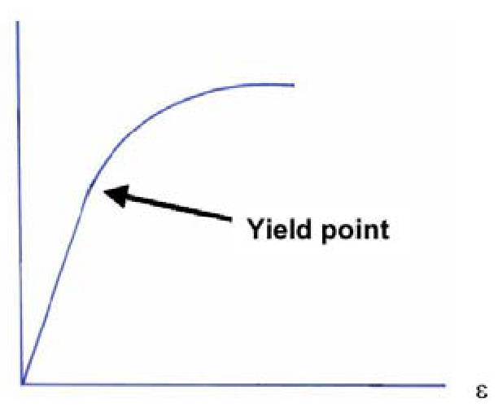
*Figure 1: The yield point, where the straight elastic line ends and the curve bends over. Lecture 11, slide 2.*

Slide 2 defines plastic deformation by three properties:

* **Stress and strain are not proportional.** Past the yield point the curve is no longer a straight line, so $\sigma = E\varepsilon$ does not apply.
* **The deformation is not reversible.** Remove the load and the specimen stays longer than it started.
* **Deformation occurs by breaking and re-arranging atomic bonds.** In crystalline materials this happens mainly by the **motion of dislocations** (Chapter 7).

**Reading Figure 1.** The steep straight part on the left is the elastic region you studied in Lecture 10 (its slope is $E$). The arrow marks where the line starts to curve. From there on, each extra bit of strain needs less extra stress than before, so the curve flattens out.

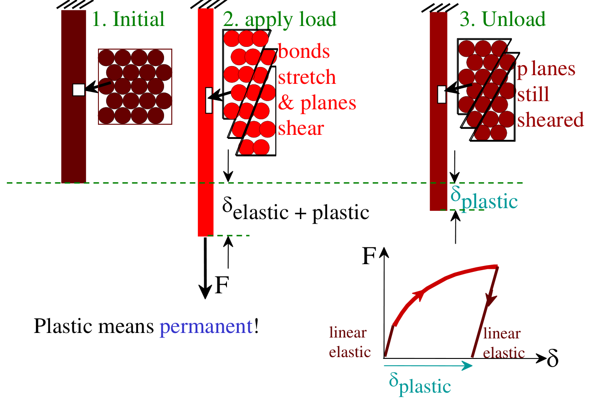
*Figure 2: "Plastic means permanent!" The bar and its atoms in three states, with the load–extension curve. Lecture 11, slide 3.*

**Reading Figure 2, left to right.**

1. **Initial.** The bar hangs from its support; the atoms sit in their regular close-packed rows.
2. **Apply load.** Two things happen at once: the **bonds stretch** (elastic) and **planes of atoms shear past each other** (plastic). The bar's end moves down by $\delta_{\text{elastic + plastic}}$.
3. **Unload.** The stretched bonds relax, so the elastic part comes back. The **planes are still sheared**, so the bar keeps a permanent extension $\delta_{\text{plastic}}$.

The small $F$–$\delta$ graph shows the same story: loading goes up the linear-elastic line and then curves (plastic); unloading comes down along a **straight line parallel to the original elastic line**, because unloading only relaxes bonds. Where it meets the axis is the permanent set $\delta_{\text{plastic}}$.

> **Why a parallel line?** The bonds are the same bonds before and after slip; the planes have simply moved one atomic spacing over. The spring constant of the bonds, and therefore $E$, has not changed, so the unloading slope is $E$ again.

---

## 2. The Proportional Limit (Slide 4)

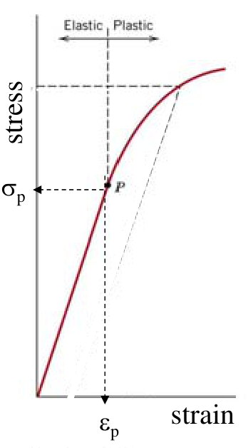
*Figure 3: The proportional limit $P$, with its stress $\sigma_p$ and strain $\varepsilon_p$. Lecture 11, slide 4.*

* The **proportional limit** $P$ is the point where the curve **stops being a straight line**: beyond it, strain is no longer proportional to stress.
* The values at that point are the **proportional-limit stress** $\sigma_p$ and **strain** $\varepsilon_p$.
* Up to $P$, the slope of the curve is the elastic modulus $E$.
* Beyond $P$, **Hooke's law can no longer be used** to relate stress and strain, in axial or in shear loading.

**Reading Figure 3.** The dashed vertical line splits the plot into "Elastic" and "Plastic". The dotted arrows read $\sigma_p$ off the stress axis and $\varepsilon_p$ off the strain axis. The faint dashed line from the strain axis, parallel to the elastic line, is the offset construction you will meet on slide 5.

In practice $P$ is hard to pin down: on a real test record the curve bends gradually, and where you say "it is no longer straight" depends on how closely you look. That is why engineers do not design with $\sigma_p$; they use the **yield strength** defined by a fixed rule (next section).

---

## 3. Yield Strength (Slides 5–6)

### 3.1 Distinct yield vs gradual yield: the 0.002 offset (slide 5)

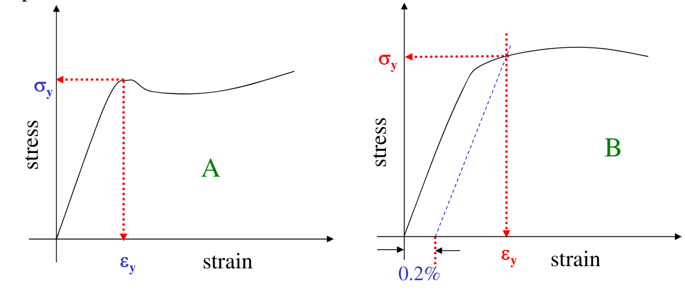
*Figure 4: Material A has a well-defined yield region; material B yields gradually, so its yield strength is found with a 0.2 % offset line. Lecture 11, slide 5.*

The **yield point** is where the material **begins to deform permanently**.

* **Material A** shows a clear yield region: the curve peaks and drops, and $\sigma_y$ is read directly.
* **Material B** bends over smoothly, with no obvious point. Here the **0.2 % offset method** gives a reproducible value:

**The offset construction, step by step.**
1. On the strain axis, mark $\varepsilon = 0.002$ (that is 0.2 %, not 0.2).
2. Draw a line through that point **parallel to the elastic part** of the curve (slope $E$).
3. Where this line cuts the curve, read the stress: that is $\sigma_y$ (and the strain there is $\varepsilon_y$).

The offset line is the unloading line you would get if you unloaded the specimen from that point (Figure 2): it would leave a permanent strain of exactly 0.002. So the 0.2 % offset yield strength means **"the stress that leaves 0.2 % permanent strain"**.

> **Slide 5, highlighted:** the yield point and the proportional limit are close to each other, but **they are not the same point**. $P$ is where the curve stops being straight; $\sigma_y$ is where permanent strain reaches the chosen offset. On most curves $\sigma_p < \sigma_y$.

### 3.2 Upper and lower yield points in low-carbon steel (slide 6)

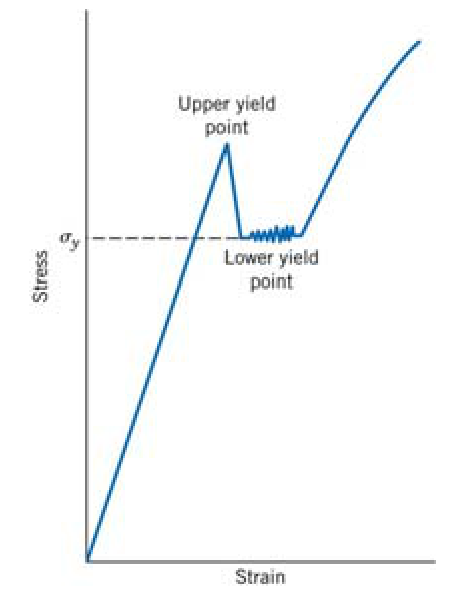
*Figure 5: Low-carbon steel shows an upper yield point, a sudden drop, and a serrated lower yield point. Lecture 11, slide 6 (Callister Fig. 6.10b).*

For a **low-carbon steel**, the curve rises to an **upper yield point**, drops suddenly, and then runs along a jagged plateau at the **lower yield point** before strain hardening begins.

**Rule from the slide:** the yield strength is the **average stress at the lower yield point**. The upper yield point is not used because it depends strongly on the test conditions (loading rate, specimen alignment, surface finish).

**Why does it happen? (beyond the slide)** Small interstitial carbon and nitrogen atoms in the iron collect around dislocations, where the lattice has room for them, and lock the dislocations in place. Freeing a locked dislocation needs extra stress (the **upper** yield point). Once dislocations break free they glide at a lower stress (the **lower** yield point), and the plastic flow spreads along the gauge length as visible bands (Lüders bands), giving the serrations.

---

## 4. Elastic Recovery: Plastic Strain Is Permanent (Slide 7)

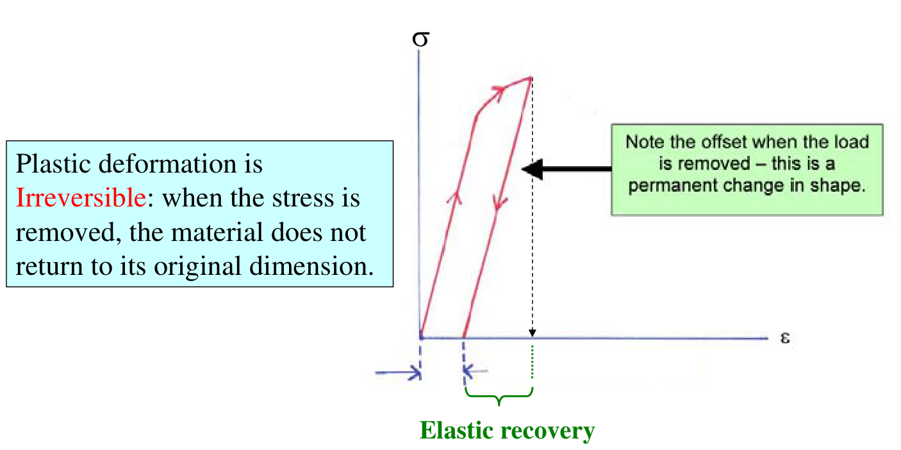
*Figure 6: Load past yield, then unload. The specimen recovers only the elastic strain; the offset left on the strain axis is a permanent change in shape. Lecture 11, slide 7.*

Slide 7 loads a specimen past its yield point and then releases it. Plastic deformation is **irreversible**: when the stress is removed, the material does **not** return to its original dimensions.

**Reading Figure 6.** The arrows go up the curve (loading), then down a straight line **parallel to the original elastic line** (unloading). The green bracket on the strain axis is the **elastic recovery**, the strain the specimen gives back. What is left between the origin and the foot of the unloading line is the **permanent (plastic) strain**:

$$
\varepsilon_{\text{total}} = \varepsilon_{\text{elastic}} + \varepsilon_{\text{plastic}}, \qquad \varepsilon_{\text{elastic}} = \frac{\sigma}{E}
$$

**Worked example (uses the slide 12 brass data).** The brass specimen ($E = 93.8$ GPa, $l_0 = 250$ mm) is loaded to $345$ MPa, where the total strain is about $0.06$, and then unloaded. How long is it afterwards?

$$
\varepsilon_{\text{elastic}} = \frac{345\ \text{MPa}}{93\,800\ \text{MPa}} = 0.0037
$$

$$
\varepsilon_{\text{plastic}} = 0.06 - 0.0037 = 0.0563 \quad\Rightarrow\quad \Delta l_{\text{permanent}} = 0.0563 \times 250\ \text{mm} = 14.1\ \text{mm}
$$

Under load the specimen was $15$ mm longer; on release it springs back only $0.9$ mm. Almost all of the deformation is permanent.

---

## 5. From Yield to Fracture (Slides 8–9)

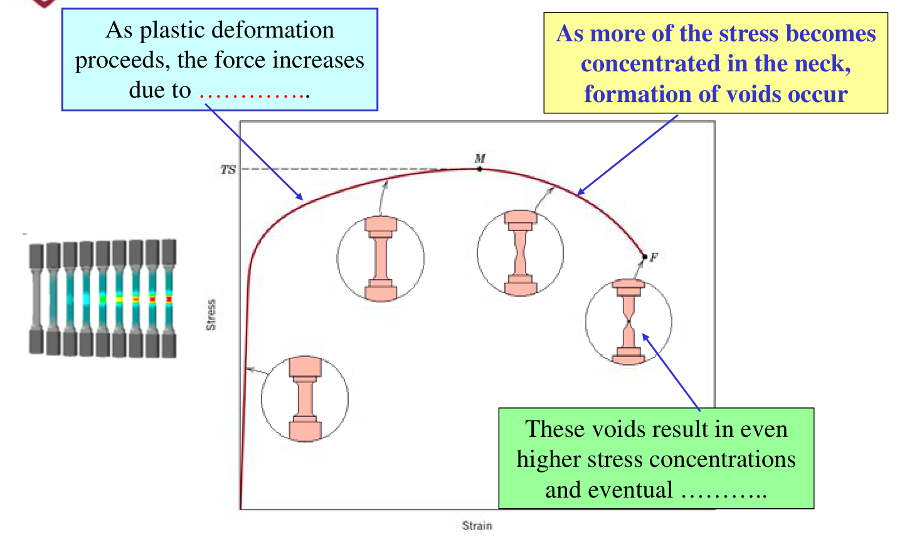
*Figure 7: The engineering stress–strain curve with the specimen shape at each stage: uniform deformation, maximum load at $TS$ (point $M$), necking and void formation, fracture at $F$. Lecture 11, slide 8 (Callister Fig. 6.11).*

**Reading Figure 7, stage by stage.**

1. **Uniform plastic deformation (yield to $M$).** The whole gauge length stretches evenly. The stress needed keeps rising because of **strain hardening**: dislocations multiply and get in each other's way (blank 1).
2. **Maximum load, point $M$ = tensile strength $TS$.** Hardening can no longer keep up with the shrinking cross-section, so the load reaches its peak.
3. **Necking.** Deformation concentrates in one small region, which thins quickly. As more of the stress concentrates in the neck, **voids form** inside it, usually at small particles or inclusions.
4. **Fracture at $F$.** The voids raise the local stress further, grow, join into a crack and the specimen breaks (blank 2: **fracture**). In a ductile metal this gives the cup-and-cone fracture surface.

The row of specimens at the left of the slide shows a real test: identical along the gauge length until the neck appears in one place.

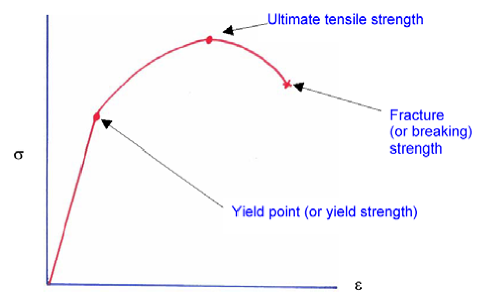
*Figure 8: The three landmarks of the curve: yield point (yield strength), ultimate tensile strength, and fracture (breaking) strength. Lecture 11, slide 9.*

**Why design uses the yield strength (slide 9).** For structural parts, **$\sigma_y$ is usually more important than $TS$**. Once the yield stress is passed, the structure has deformed **beyond acceptable limits**: a bridge member or a shaft that has permanently stretched or bent has already failed its job, even though it has not broken. $TS$ matters for things that must not separate (cables, fasteners) and for forming operations.

---

## 6. Engineering Stress vs True Stress (Slides 10–11)

### 6.1 The slide 10 question: is the specimen getting weaker?

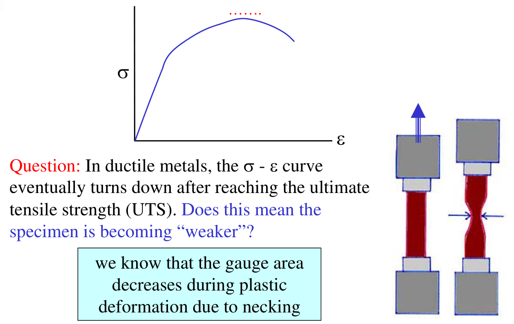
*Figure 9: The engineering curve turns down after the UTS while the specimen necks. Lecture 11, slide 10.*

**No.** Recall the definition: **engineering stress $= F/A_0$**, where $A_0$ is the **original** cross-sectional area. During necking the **actual** area in the neck shrinks quickly. The load $F$ falls because there is less metal carrying it, but $A_0$ in the denominator never changes, so the computed engineering stress falls too. The metal in the neck is still strain hardening: the stress it actually carries keeps rising until it breaks.

### 6.2 True stress and true strain (slide 11)

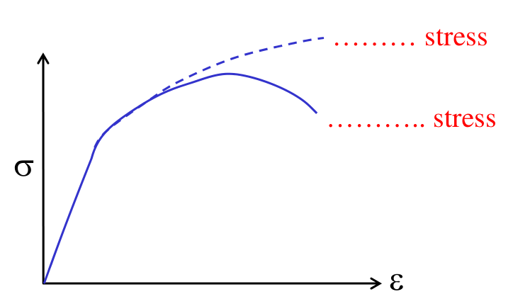
*Figure 10: True stress (dashed, upper) keeps rising to fracture; engineering stress (solid, lower) turns down after the UTS. Lecture 11, slide 11.*

Using the actual area gives the **true stress**; using the instantaneous length gives the **true strain**:

$$
\sigma_T = \frac{F}{A_i}, \qquad \varepsilon_T = \ln\frac{l_i}{l_0}
$$

Because $A_i < A_0$, engineering stress **underestimates** the real stress by the ratio $A_0/A_i$ (slide 11 writes it as $A_0/A_c$).

**Converting, before necking only.** Plastic deformation keeps the volume constant ($A_0 l_0 = A_i l_i$), which gives:

$$
\sigma_T = \sigma\,(1 + \varepsilon), \qquad \varepsilon_T = \ln(1 + \varepsilon)
$$

These formulas assume the strain is **uniform** along the gauge length. After necking starts, the strain is concentrated in the neck and you must measure the neck area directly.

**Worked example.** Brass point $A$ on slide 12: $\sigma = 345$ MPa at $\varepsilon = 0.06$ (before necking).

$$
\sigma_T = 345\,(1.06) = 366\ \text{MPa}, \qquad \varepsilon_T = \ln(1.06) = 0.058
$$

At small strains the two descriptions barely differ; the gap grows with strain and becomes large in the neck.

**Slide 11 key points.**
* The true curve gives a **more accurate** picture of how strong the material really is at fracture, but the **actual area is hard to measure in real time** during a test.
* So the values usually reported are **engineering** values.
* **True fracture strength > tensile strength**, but the engineering diagram does not show this, because its last point is divided by $A_0$.

---

## 7. Lecture Example: Brass Tensile Specimen (Slide 12)

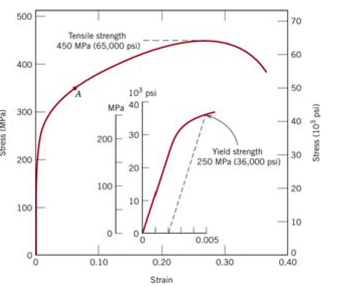
*Figure 11: Tensile stress–strain behaviour of a brass specimen; the inset magnifies the first 0.005 of strain. Lecture 11, slide 12 (Callister Fig. 6.12, Example 6.3).*

From the brass curve, determine (a) $E$, (b) the 0.002-offset yield strength, (c) the maximum load for an original diameter of $12.8$ mm, and (d) the change in length of a $250$ mm specimen at $345$ MPa.

**(a) Modulus of elasticity.** Use the **inset**, where the elastic line is readable. The line passes through the origin and through about $150$ MPa at a strain of $0.0016$:

$$
E = \frac{\Delta\sigma}{\Delta\varepsilon} = \frac{150\ \text{MPa} - 0}{0.0016 - 0} = 93\,800\ \text{MPa} = 93.8\ \text{GPa}
$$

**(b) Yield strength.** In the inset, draw the dashed line from $\varepsilon = 0.002$ parallel to the elastic line. It cuts the curve at about

$$
\sigma_y \approx 250\ \text{MPa}
$$

**(c) Maximum load.** The largest load the specimen can carry corresponds to the tensile strength, $TS = 450$ MPa, acting on the original area:

$$
A_0 = \pi\left(\frac{d_0}{2}\right)^2 = \pi\,(6.4\times10^{-3}\ \text{m})^2 = 1.287\times10^{-4}\ \text{m}^2
$$

$$
F_{\max} = TS \cdot A_0 = (450\times10^{6}\ \text{N/m}^2)(1.287\times10^{-4}\ \text{m}^2) = 57\,900\ \text{N}
$$

**(d) Change in length at 345 MPa.** $345$ MPa is far above $\sigma_y = 250$ MPa, so Hooke's law does **not** apply. Read the strain from the main curve instead (point $A$): $\varepsilon \approx 0.06$.

$$
\Delta l = \varepsilon\, l_0 = (0.06)(250\ \text{mm}) = 15\ \text{mm}
$$

> **Trap in part (d).** Writing $\varepsilon = \sigma/E = 345/93\,800 = 0.0037$ gives $\Delta l = 0.92$ mm, which is wrong: that is only the elastic part (Section 4). Always check whether the stress is below $\sigma_y$ before using Hooke's law.

---

## 8. Strain Hardening and the True Stress–True Strain Curve (Slides 13–14)

### 8.1 Strain hardening (slide 13)

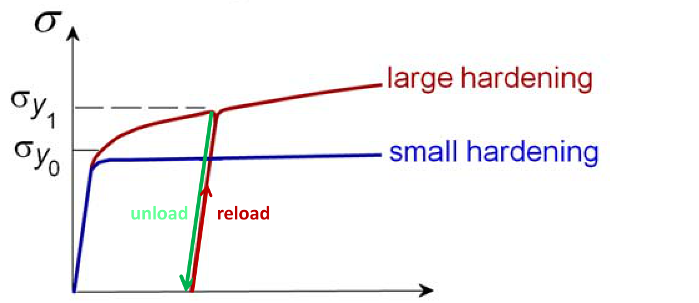
*Figure 12: Strain hardening raises the yield strength from $\sigma_{y_0}$ to $\sigma_{y_1}$ after an unload–reload cycle. Lecture 11, slide 13.*

**Strain hardening** is an **increase in $\sigma_y$ caused by plastic deformation**.

**Reading Figure 12.** The red material is loaded past its original yield strength $\sigma_{y_0}$ and **unloaded** (green, parallel to the elastic line). When it is **reloaded** (red), it behaves elastically all the way up to the stress where unloading began, so its new yield strength is $\sigma_{y_1} > \sigma_{y_0}$. The red curve rises steeply after yield (**large hardening**); the blue curve stays nearly flat (**small hardening**). This is the principle behind cold working (Chapter 7): a cold-rolled sheet is stronger than the annealed sheet it came from.

The plastic part of the true curve, from yield up to the start of necking, is fitted by a power law (the Hollomon equation):

$$
\sigma_T = K\,\varepsilon_T^{\,n}
$$

* $\sigma_T$ is the **true stress** $F/A$, and $\varepsilon_T = \ln(L/L_0)$ is the **true strain**.
* $n$ is the **strain-hardening exponent**: about $0.15$ for some steels up to $0.5$ for some copper alloys.
* $K$ is the **strength coefficient**: the true stress at $\varepsilon_T = 1$.

### 8.2 Why it is a straight line on log–log axes (slide 14)

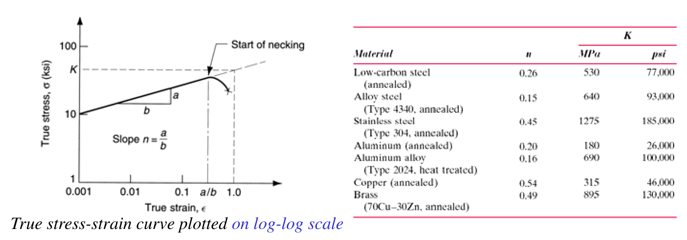
*Figure 13: The true stress–true strain curve on log–log axes is a straight line of slope $n = a/b$ up to the start of necking; the table lists $n$ and $K$ for common alloys. Lecture 11, slide 14 (table: Callister Table 6.4).*

Take logarithms of both sides:

$$
\log\sigma_T = \log K + n\,\log\varepsilon_T
$$

This is a straight line, $y = c + mx$, with slope $m = n$ and intercept $\log K$ at $\varepsilon_T = 1$ ($\log 1 = 0$). On the figure, $n = a/b$, and $K$ is read where the line reaches $\varepsilon_T = 1.0$.

**Slide 14 blank:** the **higher** the slope, the **stronger** the material becomes when it is strained. A large $n$ means every bit of extra plastic strain brings a large increase in strength.

| Material (from the slide 14 table) | $n$ | $K$ (MPa) | Comment |
| :--- | :---: | :---: | :--- |
| Low-carbon steel (annealed) | 0.26 | 530 | Moderate hardening |
| Alloy steel 4340 (annealed) | 0.15 | 640 | Low $n$: already strong, hardens little |
| Stainless steel 304 (annealed) | 0.45 | 1275 | High $n$ and high $K$ |
| Aluminum (annealed) | 0.20 | 180 | Soft |
| Aluminum alloy 2024 (heat treated) | 0.16 | 690 | Precipitates already block dislocations |
| Copper (annealed) | 0.54 | 315 | **Highest $n$**: hardens the most |
| Brass 70Cu–30Zn (annealed) | 0.49 | 895 | High $n$ |

Pattern to remember: **annealed FCC metals** (copper, brass, austenitic stainless) have high $n$; already-strengthened alloys (4340 steel, heat-treated 2024) have low $n$, because most of their hardening capacity is used up.

**Worked example 1: true stress from the Hollomon law.** Low-carbon steel at a true strain of $0.10$:

$$
\sigma_T = 530\ \text{MPa} \times (0.10)^{0.26} = 530 \times 0.550 = 291\ \text{MPa}
$$

**Worked example 2: finding $n$ and $K$ from two points.** An annealed brass gives $\sigma_T = 206$ MPa at $\varepsilon_T = 0.05$ and $\sigma_T = 407$ MPa at $\varepsilon_T = 0.20$. Divide the two Hollomon equations so that $K$ cancels:

$$
\frac{407}{206} = \left(\frac{0.20}{0.05}\right)^{n} \;\Rightarrow\; n = \frac{\ln(407/206)}{\ln 4} = \frac{0.681}{1.386} = 0.49
$$

$$
K = \frac{206\ \text{MPa}}{(0.05)^{0.49}} = \frac{206}{0.2304} \approx 894\ \text{MPa}
$$

This matches the table's brass values ($n = 0.49$, $K = 895$ MPa) to within reading accuracy.

> **Beyond the slides: when does necking start?** The load is $F = \sigma_T A$. At the maximum load $dF = 0$, so $d\sigma_T/\sigma_T = -dA/A = d\varepsilon_T$ (constant volume). With $\sigma_T = K\varepsilon_T^{\,n}$ this gives **$\varepsilon_T = n$ at the onset of necking**. A larger $n$ therefore delays necking and gives more uniform elongation, which is why high-$n$ alloys such as brass and stainless steel are chosen for deep drawing.

---

## 9. Safety Factors in Design (Slide 15)

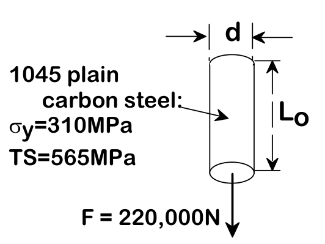
*Figure 14: Design example: a 1045 plain carbon steel rod ($\sigma_y = 310$ MPa, $TS = 565$ MPa) carrying $F = 220\,000$ N. Lecture 11, slide 15.*

Design is uncertain: loads are estimated, material properties scatter from batch to batch, and flaws may be present. So **we do not push the limit**. The allowable (working) stress is the yield strength divided by a **factor of safety** $N$:

$$
\sigma_{\text{working}} = \frac{\sigma_y}{N}, \qquad N \text{ typically } 1.2 \text{ to } 4
$$

**Example (slide 15).** Find the diameter $d$ so that the rod does not yield, using $N = 5$.

**Step 1: working stress.**

$$
\sigma_{\text{working}} = \frac{310\ \text{MPa}}{5} = 62\ \text{MPa}
$$

**Step 2: required area.** Set $F/A_0 = \sigma_{\text{working}}$:

$$
A_0 = \frac{F}{\sigma_{\text{working}}} = \frac{220\,000\ \text{N}}{62\times10^{6}\ \text{N/m}^2} = 3.55\times10^{-3}\ \text{m}^2
$$

**Step 3: diameter.** With $A_0 = \pi d^2/4$:

$$
d = \sqrt{\frac{4A_0}{\pi}} = \sqrt{\frac{4\,(3.55\times10^{-3})}{\pi}} = 0.0672\ \text{m} \approx 6.7\ \text{cm}
$$

**Check:** $\sigma = 220\,000 / [\pi (0.0672)^2/4] = 62$ MPa, which is $310/62 = 5$ times below the yield strength.

> **Traps.** (1) Using $TS = 565$ MPa instead of $\sigma_y$ gives $d \approx 5.0$ cm, a rod that would yield in service, since design against yielding must use $\sigma_y$. (2) Using $\pi d^2$ (radius formula with a diameter) or forgetting the square root. (3) Forgetting to divide by $N$ gives $d \approx 3.0$ cm, with no margin at all.

---

## 10. Exam Pitfalls & High-Yield Summary

| Concept | Correct statement | Common mistake |
| :--- | :--- | :--- |
| Plastic deformation | Permanent; $\sigma$ and $\varepsilon$ not proportional; by dislocation motion | Thinking it is "elastic but bigger" |
| Proportional limit vs yield | $P$ = end of linearity; $\sigma_y$ = 0.2 % permanent strain; close but **not the same** | Treating them as the same point |
| 0.002 offset | Line through $\varepsilon = 0.002$, **parallel to the elastic slope** | Using 0.2 as the strain, or drawing the line from the origin |
| Low-carbon steel | $\sigma_y$ = **average stress at the lower yield point** | Reporting the upper yield point |
| Unloading | Unload along a line of slope $E$; recover $\sigma/E$ only | Assuming the specimen returns to $l_0$ |
| Force rises after yield | **Strain hardening** | Saying the load rises because the area grows |
| Curve drops after $TS$ | Necking shrinks $A_i$; engineering stress still divides by $A_0$ | "The metal is getting weaker" |
| True vs engineering | $\sigma_T = \sigma(1+\varepsilon)$, $\varepsilon_T = \ln(1+\varepsilon)$, **only before necking** | Using them inside the neck |
| Hooke's law in problems | Only below $\sigma_y$; above it, read $\varepsilon$ from the curve | $\Delta l = \sigma l_0/E$ at 345 MPa for brass (0.92 mm instead of 15 mm) |
| Hollomon | $\sigma_T = K\varepsilon_T^{\,n}$; $n$ = log–log slope; larger $n$ → more hardening | Using engineering values in the power law |
| Design | $\sigma_{\text{working}} = \sigma_y / N$ | Designing against $TS$ |

**Five-line summary.**
1. Past the proportional limit and the yield point, deformation is **plastic**: permanent, non-linear, carried by dislocations.
2. Yield strength: **0.2 % offset**, or the **lower yield point** for low-carbon steel. On unloading, only $\sigma/E$ is recovered.
3. The load rises after yield because of **strain hardening**, peaks at $TS$, then **necking** and **voids** lead to **fracture**.
4. **True stress** uses the actual area and keeps rising to fracture; $\sigma_T = K\varepsilon_T^{\,n}$ with $n$ = log–log slope.
5. Design uses $\sigma_{\text{working}} = \sigma_y/N$: for the 1045 rod with $N = 5$, $d \approx 6.7$ cm.

**Next lecture (slide 16):** toughness and hardness. See the [Part 6 Master Guide](../02%20-%20Comprehensive%20Topic%20Guides%20%28Expanded%20&%20Intuitive%29/Part%206%20-%20Mechanical%20Properties%20of%20Metals%20Master%20Guide.pdf), Sections 7 and 9.
