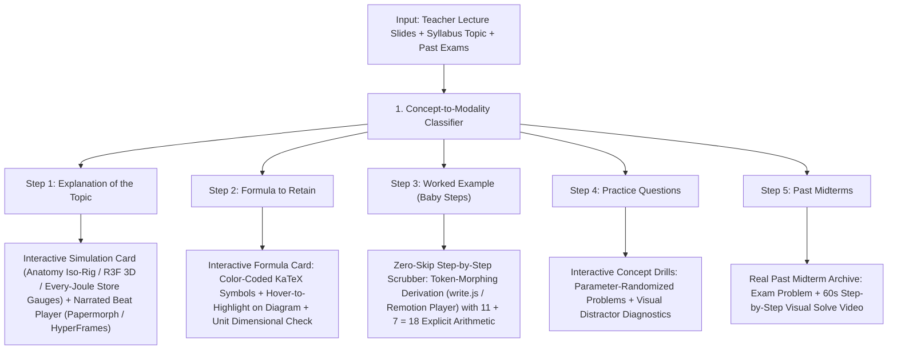

# THE NEXT STEP — Deep Research & Reverse-Engineering Blueprint for the Interactive Visual Learning Engine

> **Implementation status:** This is a research blueprint. Proposed interactive scenes, performance targets, and video exports require implementation and verification. The learner controls and assessment state must be built separately from a rendered MP4.

**Target Directory**: `001 Main/`  
**Orchestration Hub**: `motion-video-director/`  
**Scope**: Reverse-engineering analysis of 9 reference platforms/repositories + existing local engines to train and architect an AI capable of generating world-class interactive simulations, 2D/3D visual explainers, and narrated deterministic videos.

---

## Phase 1 — Analysis of Existing Local Architecture (`001 Main\`)

### 1.1 Inventory of Verified Local Subsystems
Inspection of `001 Main/` reveals four core production subsystems already on disk:

1. **`ode-motion-lessons\` (Deterministic DOM + KaTeX + SVG/Canvas Video Engine)**:
   - **Core Runtime**: `src/engine/engine.js`, `timeline.js`, `stage.css`, `index.html`.
   - **Domain Scene Builders (`src/engine/scenes/`)**:
     - *Mathematics & ODEs*: `write.js` (90 px soft-mask left-to-right equation write-on), `xy.js` (2D phase planes, slope fields, trajectories, equilibrium curves), `sheet.js` (cheat-sheet box zoom & line highlighter).
     - *Materials Science (`MIAE 221`)*: `atoms.js` (Bohr orbitals, ionic electron transfer, covalent sharing, metallic electron sea), `crystal.js` (rotating 3D SC/BCC/FCC/HCP unit cells, hard-sphere packing, ABC/ABAB stacking), `miller.js` (crystallographic directions $[uvw]$ and planes $(hkl)$), `lattice.js` (vacancy/interstitial point defects, edge dislocation glide, Cu–Ni interdiffusion), `waves.js` (Bragg's Law $n\lambda = 2d\sin\theta$ phase-locked wave interference), `grains.js` (Voronoi solidification, grain boundaries, cold-work dislocation tangles, recrystallization), `mech.js` (tensile test specimen synced to live $\sigma\text{–}\varepsilon$ curve with $0.002$ offset yield, Poisson contraction, hardness indenter).
     - *Computer Science (`MIAE 215`)*: `code.js` (step-by-step C++ execution tracer with line highlights and variable watch tables), `arrays.js` (memory cell pointers and index sweeps).
     - *Industrial Engineering (`INDU 211`)*: `doodle.js` (seeded hand-drawn ink engine on `#FCFBF7` dotted paper with wobbly strokes for MRP records, BOM trees, CPM/PERT networks, EOQ sawtooth inventory plots, and queuing diagrams).
   - **Audio & Render Pipeline**: Local `Kokoro-82M` TTS (`af_heart`, speed `0.90–0.96`), procedural WebAudio/Python SFX (`whoosh`, `tick`, `swish`, `chime`, `thud`), word-level beat synchronization (`plan/beats/<id>.json`), headless Chrome frame capture (`puppeteer-core`), and two-pass `-16 LUFS` FFmpeg mastering.

2. **`motion-video-director\` (Master Director Skill & Multi-Skill Hub)**:
   - Deterministic planning, storyboard beat locking (`plan/beats.json`), contact-sheet visual QA (`--sheet`), local audio analysis (FFmpeg, librosa, NumPy/SciPy), and ElevenLabs/procedural SFX synthesis.
   - Now houses the unified `skills/`, `repos/`, and `rea/` subdirectories consolidating all 24 visual-learning skills in one structure.

3. **`01 - Video & Motion Graphics\` (Local Graphics & Audio Libraries)**:
   - Contains local clones of `react-three-fiber`, `drei`, `react-spline`, `theatre`, `p5.js`, `paper.js`, `leaferjs`, `plotly.js`, `molstar` (molecular/crystal 3D viewer), `openmontage`, `piper`, `whisper`, and `whisperx`.

4. **`insta-reels\` (`https://ireels.vercel.app/#f=concordia`)**:
   - Curated intelligence catalog (`video-catalog.json` and `website/data/catalog.json`) with a dedicated `#f=concordia` filter (`v.co === true`) tracking 9 high-yield visual learning pipelines.

### 1.2 Strengths & Current Limitations of the Existing System
- **Strengths**:
  - **100% Deterministic Video Output**: Frame-by-frame headless Chromium capture eliminates frame drops and browser jitter.
  - **Curriculum-Locked Accuracy**: Every visual scene is driven by verified mathematical formulas and professor slide examples.
  - **Zero-Cost Local Voice & SFX**: `Kokoro-82M` + procedural SFX produce clean studio audio offline.
- **Limitations Identified**:
  1. **One-Way MP4 Delivery**: The rich scene builders in `ode-motion-lessons/src/engine/scenes/` (`crystal.js`, `mech.js`, `xy.js`, `waves.js`) are rendered offline to flat `.mp4` files rather than mounted live in the student's browser with interactive sliders, orbital cameras, or direct manipulation.
  2. **Lack of Isometric Physical Apparatus Primitives**: Diagrams are 2D projections or simple wireframes rather than dense, tactile physical instruments (dial gauges, test rigs, micrometers, lathe-turned shafts) with true depth sorting.
  3. **No Inline Interactive Checkpoints Inside Video Beats**: Videos play linearly without pausing inside the SVG/Canvas stage for student manipulation or mid-scene concept checks.
  4. **Manual Scene Authoring Overhead**: Each new animation requires hand-coding low-level canvas/SVG coordinates rather than composing declarative scene graphs (`Anatomy` solids, `Papermorph` beats, `HyperFrames` timelines, or `Manim` mobjects).

---

## Phase 2 — Reference-by-Reference Reverse Engineering

> **Verification Standard**: Every section below explicitly separates **Verified Implementation Details** (proven via inspected repository source code or captured HTTP/JS bundles in `motion-video-director/rea/`) from **Inferred / Observable Behavior** (where server-side or unbundled source code is private).

---

### 2.1 `https://ximmersion.dev/#showcases` (xImmersion by Tommy)
- **Verified Implementation Details** *(from captured `ximmersion.html` [64,190 bytes] and `ximmersion-global.js` [532,895 bytes])*:
  - **Core Positioning**: Gamified 3D learning simulations, interactive product tours, CAD-to-3D web configurators, and SCORM-compatible LMS modules.
  - **Embedded Engine Stack**:
    1. **Needle Engine (`https://engine.needle.tools/`)**: Unity/Blender-to-Three.js glTF web runtime powering `samples-uploads/physics-animation/`, `basic-physics/`, `joints/`, `product-flyover/`, and `scrollytelling-bike-z23hmxb2gnu5a.needle.run/`.
    2. **Verge3D (`https://cdn.soft8soft.com/demo/blender/factory_tour/factory_tour.html`)**: Blender-authored industrial factory tour with clickable 3D hotspots, camera tweening between workstations, and HTML UI overlays.
    3. **Unity WebGL (`assets/js/animal-vocab-unity-init.js`)**: Used for gamified learning modules.
- **Observable UX & Pedagogical Patterns**:
  - **"Drag to Explore / Click a Hotspot"**: Instead of passive video, the learner orbits a 3D assembly, clicks glowing callout pins on mechanical joints, and triggers localized animations (e.g., exploding a gearbox or tracing factory material flow).
  - **Scroll-Scrubbed 3D Camera (`scrollytelling-bike`)**: Page scroll progress $p \in [0, 1]$ drives a spline camera path around a 3D mechanical model while syncing callout cards.

---

### 2.2 `https://www.arxivisual.org` (arXivisual)
- **Verified Implementation Details** *(from captured `arxivisual.html` [48,365 bytes], `arxivisual-sample.html` [19,844 bytes], and `ireels` `vid_301`)*:
  - **Frontend Stack**: Next.js App Router with Turbopack (`turbopack-2k9r7d5d5poo3.js`).
  - **URL Routing Pattern**: Replaces `arxiv.org/abs/<id>` with `arxivisual.org/abs/<id>` (e.g., `1706.03762` *Attention Is All You Need*, `2005.14165` *GPT-3*, `2303.08774` *GPT-4*).
  - **Rendering Backend**: Uses **Manim** (3Blue1Brown mathematical animation style) to convert dense academic PDFs into narrated visual explainers.
- **Inferred Backend Pipeline** *(server-side generation pipeline is not publicly exposed)*:
  1. **PDF Ingestion & Concept Graph Extraction**: Extracts LaTeX equations, figures, and section hierarchy from the arXiv source tarball or PDF.
  2. **"Hardest Concept First" Pedagogical Script**: Instead of reading the abstract verbatim, an LLM restructures the paper around visual intuition $\to$ core equation breakdown $\to$ architecture dataflow animation.
  3. **Automated Manim Scene Synthesis**: Generates Python `Scene` classes using `MathTex`, matrix transformations, and attention-weight heatmaps, rendered per beat and stitched with TTS narration.

---

### 2.3 `https://iamtechartist.com/every-joule/` (Every Joule — 3D Interactive Physics Book)
- **Verified Implementation Details** *(from captured `every-joule.html` [65,990 bytes], `every-joule-app.html` [15,758 bytes], `every-joule-main.js` [160,770 bytes], and `ireels` `vid_302` referencing `iamtechartist/every-joule-lesson1`)*:
  - **Architecture**: Built as a 10-lesson interactive 3D web book (`/Apps/every-joule/`) using modular ES chunks:
    - Core Three.js bundle: `./three-PaSYbO4s.js`
    - Shared spring/physics dynamics: `./spring-BONj-Pu7.js`
    - Individual lesson modules: `./lesson3-xfpU_Ux2.js` through `./lesson10-D1qf_ict.js`.
  - **Core Pedagogical Mechanic — "The Jars of Energy"**:
    - Every interactive 3D diagram (a falling book, a rolling ball on a track with friction, a stretched coil spring) is paired with **live visual "Energy Jars"** representing the 8 energy stores (gravitational potential $E_p = mgh$, kinetic $E_k = \frac{1}{2}mv^2$, thermal, elastic).
    - As the student drags the ball or releases the spring in 3D, conservation of energy is enforced mathematically in a single state model: the liquid level in the Gravitational Jar drains in real time into the Kinetic Jar, while friction bleeds a proportional fraction into the Thermal Jar.
  - **Graceful Progressive Enhancement**: Includes a hardware-acceleration check; if WebGL is unavailable, the full lesson text, equations, definitions, and teacher notes remain readable.

---

### 2.4 `https://github.com/ManimCommunity/manim` (Manim Community v0.19+)
- **Verified Implementation Details** *(inspected local archive at `motion-video-director/repos/manim`, commit `16ea443e`, 901 files)*:
  - **Scene Graph (`Mobject` / `VMobject`)**: All 2D/3D mathematical objects inherit from `Mobject`; vectorized paths (`VMobject` in `manim/mobject/types/vectorized_mobject.py`) represent shapes and LaTeX glyphs as arrays of cubic Bézier control points (`points` array of shape $(4N, 3)$).
  - **LaTeX Morphing (`manim/animation/transform_matching_parts.py`)**:
    - `TransformMatchingTex` splits a `MathTex` equation into submobjects by `{{ ... }}` token boundaries, matches identical symbols between source and target equations, and interpolates their Bézier control points along smooth arcs while cross-fading unmatched symbols.
  - **Reactive Update Loop**:
    - `ValueTracker` holds a scalar parameter; `always_redraw(func)` or `mobject.add_updater(lambda m, dt: ...)` recomputes geometry every frame (`1/fps`), guaranteeing that curves, Riemann rectangles, tangent vectors, and labels never desynchronize.
  - **Note on `ManimGX` (`ireels` `vid_309`)**: Referenced in the Concordia catalog as a Rust + `wgpu` GPU-accelerated port of Manim for rapid 3D math rendering.

---

### 2.5 `https://github.com/heygen-com` (`heygen-com/hyperframes` & `heygen-com/skills`)
- **Verified Implementation Details** *(inspected local archives at `motion-video-director/repos/hyperframes` [commit `4cabfd18`, 1,172 files] and `repos/heygen-skills` [commit `1bd5e4d3`, 47 files])*:
  - **HyperFrames Core Architecture (`packages/core`, `packages/engine`, `packages/player`)**:
    - **HTML-to-Video Deterministic Contract**: Every timed DOM element carries `class="clip"`, `data-start="<seconds>"`, and `data-duration="<seconds>"`.
    - **Global Timeline Registry**: Each scene file wraps its markup in `<template>` and registers a paused GSAP/animation timeline on `window.__timelines["<data-composition-id>"] = tl`.
    - **Frame-Accurate Seeking**: During export, the headless engine seeks `tl.time(frame / fps)` deterministically—banning `Date.now()`, unseeded `Math.random()`, CSS transitions, and `repeat: -1`.
    - **Editable Variables**: Text, colors, and media use `data-var-text`, `data-var-src`, and CSS custom properties so non-coders can edit scenes in the visual studio preview (`npx hyperframes preview`).
  - **HeyGen Skills (`heygen-avatar`, `heygen-video`, `heygen-translate`)**:
    - Provides API workflows for inserting an AI instructor talking head (`heygen-avatar`, overlaid in a corner or split-screen via `/media-use`) and translating/lip-syncing completed course videos into French or other languages (`heygen-translate`).

---

### 2.6 `https://github.com/remotion-dev/remotion` (Remotion)
- **Verified Implementation Details** *(inspected local archive at `motion-video-director/repos/remotion`, commit `0914e325`, 821 files + 13 sub-skills in `motion-video-director/skills/remotion-*`)*:
  - **Pure Functional Frame Model (`packages/core`)**:
    - Every React component reads `const frame = useCurrentFrame()` and `const { fps, durationInFrames, width, height } = useVideoConfig()`.
    - Animations are pure mathematical functions of `frame`: `interpolate(frame, [0, 30], [0, 1], { extrapolateRight: 'clamp' })` and physics-based `spring({ frame, fps, config: { damping: 200 } })`.
  - **Dual Interactive + Video Runtime (`packages/player` & `remotion-interactivity`)**:
    - The exact same React `<Composition />` can be mounted live inside the Concordia web portal using `<Player component={LessonScene} inputProps={{ strain: userSliderValue }} controls />` **OR** rendered server-side to an `.mp4` via `@remotion/renderer`.
    - This solves the "write once, run as interactive web widget AND downloadable MP4 video" problem.

---

### 2.7 `https://github.com/DozenTwelve/Papermorph` (Papermorph)
- **Verified Implementation Details** *(inspected local archive at `motion-video-director/repos/papermorph`, commit `31d8b583`, 137 files, plus `skills/papermorph/SKILL.md`)*:
  - **Interactive Narrated Web Book Engine (`engine/`)**:
    - Uses a fixed `1600×900` SVG stage (or `900×1600` for mobile vertical shorts) paired with an audio-beat player (`timings.js`).
    - **Beat-Driven Choreography**: Each chapter (`chNN/index.html`) is divided into discrete **beats**. Each beat pairs a narration audio clip (`audio/<lang>/beat_NN.mp3`) with timed SVG actions (drawing diagrams, moving pointers, highlighting terms) and **inline interactive checks** (`references/lessons/questions.md`) where the student answers or clicks directly inside the SVG diagram before the next beat continues.
  - **Automated Verification Scripts (`SKILL/scripts/`)**:
    - Includes `check_blank.py` (detects empty visual openings), `overlap.py` (detects arrows cutting through text labels!), `still.py` (flags stretches where nothing moves on screen), `perf.py` (measures frame times), and `export.py` (converts the interactive web chapter into an `.mp4` + `.srt`).

---

### 2.8 `https://github.com/wheresryan22/anatomy` (Anatomy)
- **Verified Implementation Details** *(inspected local archive at `motion-video-director/repos/anatomy`, commit `1482e846`, 173 files, plus `skills/anatomy/SKILL.md`)*:
  - **Core Philosophy — "The Object Is the Explanation"**:
    - Replaces abstract boxes-and-arrows with a tactile, 40–150 part **isometric physical machine** (a tensile test rig with coil springs and a dial indicator, a ripple tank with caustics, a rocket engine on a test stand, a spot plate with feeler blades).
    - Every readout number on screen is computed from the **exact same pure mathematical model** (`model.mjs` / `rig.ts`) that moves the physical parts.
  - **Verified Geometry & Shader Kit (`kit/`)**:
    - `kit/iso-kit.ts` / `iso-kit.mjs`: Isometric projection camera (`azimuth: 45°`, `elevation: 30°`), 4-tone surface shading (`lo`, `mid`, `hi`, and a single `lit` focal part), bevels, knurled knobs, coil springs, ruler ticks, and screw dots.
    - `kit/lathe.mjs` & `kit/tube.mjs`: Analytic turned bodies of revolution (`lathe`, `bandsOf`, `rodOut`) and 3D depth-sorted pipes/cables (`tubePieces`).
    - `kit/audit.mjs`: **Automated 3D Geometry Prover** (`node build.mjs --audit`) that ray-casts every overlapping pair across rest, exploded, and mid-motion states to prove **zero part collisions, zero loose ends, and 100% mathematically true painter's depth order** (`A.settle(R, P)`).
    - `kit/gl.mjs`: Sandwiches a world-space WebGL shader canvas (`GLSL_ISO`) *between* a back SVG layer and a front SVG layer for physical phenomena that lines cannot draw (water waves, caustics, stress heatmaps, furnace glow, laser diffraction).
    - `scripts/lines.mjs`: Headless Chrome verifier ensuring `line ends: 0` (no floating or unanchored lines).
    - `scripts/print.mjs`: Exports any live interactive figure directly into a high-resolution A4/Letter printable PDF poster or technical drawing sheet.

---

### 2.9 `https://ireels.vercel.app/#f=concordia` (iReels Concordia Intelligence Catalog)
- **Verified Implementation Details** *(inspected `ireels.html`, `ireels-app.js`, and `ireels-catalog.json`)*:
  - Filtering by `#f=concordia` (`v.co === true` in `catalog.json`) surfaces 9 curated blueprints (`vid_295`, `vid_298`, `vid_301`, `vid_302`, `vid_303`, `vid_306`, `vid_308`, `vid_309`, `vid_310`) specifically selected to upgrade the Concordia Engineering study portal (`concordiainfo`):
    1. **Paper-to-Video Manim Explainers** (`vid_301` — ArxiVisual)
    2. **Interactive 3D Physics Book with Live Store Jars** (`vid_302` — Every Joule + Colorfigures/Anatomy)
    3. **PDF-to-Narrated Interactive SVG Web Lessons** (`vid_310` — Papermorph)
    4. **Deterministic HTML-to-Video Documentary Engine** (`vid_308` — HeyGen HyperFrames)
    5. **5-Style Video Skill Matrix** (`vid_306` — HyperFrames, Continuous Camera, Collage B-Roll, Painted Cartoon, Remotion)
    6. **GPU-Accelerated 3D Math Rendering** (`vid_309` — Manim / ManimGX)
    7. **Prompt-to-3D Web Simulations** (`vid_295`, `vid_303` — Three.js + Claude)
    8. **9-Step Bible-to-Render Production Pipeline with 3 Approval Gates** (`vid_298`).

---

## Phase 3 — Reverse-Engineered Techniques & Technology Comparison

### 3.1 How the 10 Core Visual Learning Techniques Work

1. **Structuring Interactive Educational Animations**:
   - **Pure Physics/Math Model First (`rig.ts` / `model.mjs`)**: Never animate visual coordinates directly with arbitrary keyframes. Build a pure state module `state = computeModel(inputs)` that takes student parameters (e.g., force $F$, angle $\theta$, damping $\zeta$) and outputs exact physical positions, stresses, and equation values. Both the SVG/3D view and the numeric readout subscribe to this single model.
2. **Transforming Mathematical Formulas into Visual Explanations**:
   - **Semantic Color-Coding & Token Binding**: Assign every variable in a KaTeX/MathTex equation a permanent hex token (e.g., $x$ = `#38BDF8` cyan, $y$ = `#FBBF24` amber, $\sigma$ = `#F472B6` pink, verified answer = `#34D399` green). Use matching color strokes on the physical diagram (e.g., the shear plane in Schmid's Law is drawn in the exact same `#38BDF8` cyan as $\cos\lambda$ in the formula).
   - **Token-Preserving Morphs**: When rearranging $\sigma = \frac{F}{A_0}$ to $F = \sigma A_0$, move the DOM/SVG bounding boxes of `F`, `\sigma`, and `A_0` along cubic Bézier arcs (`1.1s easeInOutCubic`) rather than cross-fading whole lines.
3. **Student-Controlled 2D & 3D Simulations**:
   - **Direct Object Manipulation + Linked Store Bars (*Every Joule* + *Anatomy* pattern)**: Allow students to drag a physical probe/knob on the apparatus *or* scrub a parameter slider. Alongside the apparatus, render live "Store Gauges" (e.g., Elastic Strain Energy vs. Plastic Work in `MIAE 221`, or Kinetic vs. Potential Energy) that fill and drain in real time.
4. **Scroll-Driven & Timeline-Based Animations**:
   - **Unified Progress Parameter $t \in [0, T]$**: Whether driven by audio playback (`Papermorph` / `HyperFrames`), user scroll (`GSAP ScrollTrigger` / `XImmersion`), or a scrub bar (`Remotion <Player />`), all scene mutations evaluate a deterministic function `renderAtTime(t)`.
5. **Generating Cinematic Motion Graphics**:
   - **Camera Choreography + Layered Depth**: Combine a `1600×900` or `1920×1080` stage with virtual camera pan/zoom matrices, 4-tone isometric shading (`lo`, `mid`, `hi`, `lit`), and a sandwiched WebGL shader layer (`kit/gl.mjs`) for continuous fields (stress distributions, wave interference, thermal diffusion).
6. **Synchronizing Narrated Videos with Animations**:
   - **Beat-Locked Audio Cues (`plan/beats.json` / `timings.js`)**: Generate TTS audio per script sentence first (`Kokoro-82M`), measure exact WAV duration and word timestamps via `whisperx` or `tts.py`, and bind visual action triggers (`@word` cues) to those exact millisecond offsets.
7. **Converting Interactive Experiences into Video (Dual-Target Rendering)**:
   - Expose a global `window.__seekTo(timeInSeconds)` hook on every interactive web component. In the browser, `requestAnimationFrame` + pointer events drive it; for video export, `HyperFrames` or `ode-motion-lessons/src/tools/render.mjs` steps `window.__seekTo(frame / 30)` in headless Chrome and pipes PNG frames to FFmpeg.
8. **Supporting Mobile Devices (390 px Width) Without Losing Quality**:
   - **Vector SVG + Capped DPR WebGL**: Keep mechanical parts in crisp vector SVG (`viewBox` auto-scales on Retina screens with zero blur), cap WebGL canvas `devicePixelRatio` at `1.5`, stack controls vertically below the figure card on `< 640px` viewports, and pause offscreen canvases via `IntersectionObserver` (`useInView`).
9. **Automated Visual QA (Zero-Overlap & Zero-Blank Verification)**:
   - Before publishing any visual or video, run automated geometric checks: `Anatomy`'s `audit.mjs` (ray-cast depth & collision check), `lines.mjs` (no dangling lines), and `Papermorph`'s `overlap.py` (bounding-box check ensuring arrows/shapes never collide with text or KaTeX equations).
10. **AI Modality Selection (Choosing the Right Visualization per Concept)**:
    - Use a deterministic **Concept-to-Modality Classifier** (defined in Phase 4 below) that maps the structure of the engineering concept (apparatus vs. derivation vs. 3D lattice vs. code trace vs. process network) to the optimal engine.

---

### 3.2 Technology Stack Comparison Matrix

| Technology | Best Pedagogical Use Case | Interactive in Browser? | Deterministic MP4 Export? | Mobile Performance | Authoring Complexity | Role in Our Engine |
|---|---|---|---|---|---|---|
| **Anatomy (`iso-kit` + `gl.mjs`)** | Physical instruments, test rigs, 3D mechanisms, cross-sections | **Yes** (60 fps SVG + WebGL) | **Yes** (via `drive.mjs` + print PDF) | **Excellent** (Vector SVG + 1.5x DPR cap) | Medium (40–80 parts, audited) | **Primary Engine for Physical Apparatus & Engineering Rigs** |
| **Papermorph (`SVG Beat Stage`)** | Narrated step-by-step lessons with inline interactive quizzes | **Yes** (Play/pause + inline checks) | **Yes** (`export.py` to MP4 + SRT) | **Excellent** (Responsive SVG stage) | Low–Medium | **Primary Engine for Interactive Narrated Topic Walkthroughs** |
| **Ode-Motion-Lessons (`DOM + KaTeX`)** | Chalkboard equation derivations, code tracing, INDU doodle sheets | Currently MP4 only *(easy to mount in iframe)* | **Yes** (Puppeteer + FFmpeg `-16 LUFS`) | **Excellent** | Low (Existing 15 scene builders) | **Primary Engine for Step-by-Step Math & Worked Examples** |
| **HyperFrames (`HTML Timeline`)** | Multi-scene explainers, documentaries, kinetic typography | Preview in Studio | **Yes** (`npx hyperframes render`) | High | Low (Declarative HTML + GSAP) | **Primary Engine for High-Paced Concept Overview Videos** |
| **Remotion (`React + <Player />`)** | React-integrated interactive video widgets inside the course portal | **Yes** (`@remotion/player` with live props) | **Yes** (`@remotion/renderer`) | High | Low–Medium (Standard React/TS) | **Primary Wrapper for Embedding Live Scrubbable Videos in React** |
| **Three.js / React Three Fiber** | True 3D orbital unit cells (FCC/BCC/HCP), 3D energy books (*Every Joule*) | **Yes** (Full 3D orbit + sliders) | Via headless WebGL capture | Good (Needs DPR cap & instancing) | Medium | **Primary Engine for 3D Crystallography & Spatial Fields** |
| **Manim (`Python`)** | Complex 3Blue1Brown LaTeX morphs, 3D vector fields, Fourier series | No (Pre-rendered video clips) | **Yes** (Native MP4/WebM) | N/A (Video playback) | Low–Medium (Python DSL) | **Specialized Clip Generator for Advanced Calculus / ODE Fields** |

---

## Phase 4 — Architecture of the Improved Interactive Learning Engine

### 4.1 End-to-End Pedagogical & Visual Pipeline

When given any Concordia course topic (e.g., *ENGR 213 Undetermined Coefficients*, *MIAE 221 Dislocation Slip & Schmid's Law*, *MIAE 215 Pointer Arithmetic*, or *INDU 211 MRP Lot-Sizing*), the AI generates a unified **5-Section Interactive Learning Module** where visual engines power each step:

### 4.2 How the AI Selects the Best Visualization Method (Modality Classifier)

| Subject & Concept Archetype | Selected Visual Modality | Concrete Visual Mechanics |
|---|---|---|
| **Physical Testing / Lab Apparatus** *(Tensile test, Bragg XRD, Charpy impact, Hardness indentation, Ripple tank)* | **Anatomy Isometric Rig + WebGL Shader (`anatomy`)** | 50-part isometric machine (`iso-kit.mjs`) with movable carriage/indenter, WebGL stress/wave shader (`gl.mjs`), and live dial readout driven by pure math model. |
| **3D Spatial Geometry** *(Unit cells SC/BCC/FCC/HCP, Miller indices $[uvw]$ & $(hkl)$, interstitial sites)* | **React Three Fiber + Every-Joule Store Gauges (`R3F` + `crystal.js`)** | Orbitable 3D unit cell with slice-plane slider, atomic radius packing toggle (ball-and-stick $\leftrightarrow$ hard sphere), and live APF/density bar gauges. |
| **Differential Equations & Mathematical Derivations** *(Separable, Integrating Factor, Undetermined Coefficients, Laplace)* | **Token-Morphing Chalkboard + Phase Plane (`ode-motion-lessons` + `manim`)** | Left pane: step-by-step KaTeX derivation with color-coded variable morphing (`#38BDF8` $x$, `#FBBF24` $y$). Right pane: live direction field (`xy.js`) where student drags initial condition $(x_0, y_0)$ and watches the solution curve snap to the equilibrium. |
| **Code Execution & Memory Pointers** *(C++ loops, arrays, pointers, recursion, Arduino I/O in `MIAE 215`)* | **Deterministic State-Machine Memory Stage (`code.js` + `arrays.js` + `anatomy`)** | Split stage: left shows C++ code with active line glow; right shows physical RAM address boxes, pointer arrows that physically re-anchor on each beat, and live `cout` terminal monitor. |
| **Operations Research & Production Systems** *(BOM trees, MRP tables, CPM/PERT networks, EOQ, Queuing in `INDU 211`)* | **Interactive Polished Doodle Canvas (`doodle.js` + `papermorph`)** | Cream dotted grid (`#FCFBF7`) where clicking any MRP cell highlights its upstream Gross Requirement and parent BOM node with animated ink arrows. |

---

## Phase 5 — Reusable Patterns, Concrete Course Examples & Implementation Roadmap

### 5.1 Five High-Yield Reusable Visualization Patterns to Adopt Immediately

1. **The "Pure Model + Dual View" Pattern (from *Anatomy* & *Every Joule*)**:
   - Write every topic's math as a tiny pure TypeScript file `model.ts` (e.g., `computeTensileState(strain, E, sigmaY, K, n)`).
   - Bind that single function to:
     1. The physical specimen geometry (necking/elongation),
     2. The live cursor on the $(\varepsilon, \sigma)$ plot,
     3. The "Energy Store Jars" (recoverable elastic resilience $U_r$ vs. permanent plastic work), and
     4. The numeric readout in the card corner.
2. **The "Interactive Formula Symbol Linker"**:
   - In **Step 2 (Formula to Retain)**, hovering or tapping any symbol in the KaTeX formula (e.g., $d_{hkl}$ in $n\lambda = 2d_{hkl}\sin\theta$) pulses the corresponding geometric feature on the adjacent SVG/3D diagram in matching color and displays its physical meaning and SI unit.
3. **The "Inline Beat Checkpoint" (from *Papermorph*)**:
   - Instead of letting a 5-minute video play passively from start to finish, pause at the key pivot beat (e.g., *"Which root case applies when $b^2 - 4ac < 0$?"* or *"Click the slip plane with the highest atomic planar density"*). Once the student clicks on the stage, the animation immediately verifies and resumes.
4. **The "Zero-Overlap & Line-End Automated Gate" (from *Anatomy* & *Papermorph*)**:
   - Run `overlap.py` / `audit.mjs` checks on generated SVG/HTML scenes so no text label, dimension arrow, or KaTeX equation ever collides with a diagram stroke.
5. **The "One Source $\to$ Web Widget + MP4 + Printable PDF" Triad**:
   - Every figure built with the unified kit renders as:
     - An interactive 60 fps web widget inside the course lesson page,
     - A deterministic `.mp4` narrated clip (`window.__seekTo`), and
     - A 1-page vector PDF revision sheet (`scripts/print.mjs`).

---

### 5.2 Concrete Examples of Teaching Difficult Concepts with the New Engine

#### Example 1 — MIAE 221: Plastic Deformation, Elastic Recovery & True Stress (Lectures 11–12)
- **Step 1 (Explanation & Interactive Rig)**:
  - An **Anatomy isometric tensile test machine** (`55 solids`) holds a cylindrical metal specimen with an extensometer clipped to its gauge length.
  - Beside the rig sit two **Every-Joule energy jars**: *Elastic Resilience ($U_r$, cyan)* and *Plastic Deformation Work (amber)*, plus a live $\sigma\text{–}\varepsilon$ curve.
  - **Student Control**: A `"Load / Unload"` slider lets the student pull the specimen past the $0.002$ yield point into the strain-hardening region ($\sigma_T = K\varepsilon_T^n$) and then release the load. The student visually watches the specimen spring back along a line parallel to Young's Modulus $E$, seeing the elastic jar drain to zero while the permanent plastic elongation remains locked in.
- **Step 2 (Formula to Retain)**:
  - Interactive symbol cards for $\sigma_T = \sigma(1 + \varepsilon)$, $\varepsilon_T = \ln(1 + \varepsilon)$, and $\sigma_T = K\varepsilon_T^n$, where clicking $A_i$ vs. $A_0$ cross-sections the 3D specimen neck to show why true stress diverges upward from engineering stress.
- **Step 3 (Worked Example with Baby Steps)**:
  - Synchronized scrubber stepping through a ductile alloy calculation with zero skipped algebra (showing every logarithm, exponentiation, and unit conversion explicitly).

#### Example 2 — ENGR 213: 2nd-Order ODEs, Damping & Undetermined Coefficients (Lectures 11–12)
- **Step 1 (Explanation & Interactive Rig)**:
  - An **Anatomy spring-mass-dashpot test stand** paired with a complex $s$-plane root locus ($\alpha \pm i\beta$) and a time-response plot $y(t)$.
  - **Student Control**: Dragging the dashpot damping coefficient $c$ smoothly moves the characteristic roots $m_{1,2} = \frac{-c \pm \sqrt{c^2 - 4mk}}{2m}$ along the complex plane—visibly transitioning the physical mass from **underdamped oscillation** ($c^2 < 4mk$) $\to$ **critically damped** ($c^2 = 4mk$) $\to$ **overdamped creep** ($c^2 > 4mk$).
  - Turning on an external forcing function $g(t) = F_0 \cos(\omega t)$ demonstrates **Pure Resonance** when $\omega \to \omega_0$, visually explaining *why* the Modification Rule multiplies the trial particular solution $y_p$ by $x$.

---

### 5.3 Prioritized Implementation Roadmap

| Priority | Phase | Actionable Deliverable | Effort | Impact |
|---|---|---|---|---|
| **P0 (Immediate)** | **1. Unified Skill Hub** | Consolidate all repos (`manim`, `remotion`, `papermorph`, `anatomy`, `hyperframes`, `heygen`) + REA captures inside `001 Main\motion-video-director\` with `SKILL_ROUTER.md` **(Completed)**. | Done | Eliminates context bloat while keeping all 24 visual skills accessible on demand. |
| **P1 (High)** | **2. Live Browser Mounting of Existing Scene Builders** | Wrap `ode-motion-lessons/src/engine/scenes/` (`mech.js`, `crystal.js`, `xy.js`, `waves.js`, `doodle.js`) in a lightweight React component with parameter sliders so students can scrub and manipulate them live inside the Concordia course player during **Step 1 (Explanation)**. | 1–2 days | Instantly turns existing static MP4 code into interactive simulations across all 4 courses. |
| **P2 (High)** | **3. Interactive Formula Symbol Highlighter** | Enhance `FormulaNotes` in `StepViews.tsx` so clicking any defined symbol highlights its visual counterpart in the lesson diagram and shows a dimensional unit breakdown. | 1 day | Directly strengthens **Step 2 (Formula to Retain)**. |
| **P3 (Medium)** | **4. Anatomy Isometric Apparatus Library for Core Labs** | Build 4 signature isometric interactive rigs using `anatomy/kit/iso-kit.mjs`: (1) Tensile & Hardness Rig (`MIAE 221`), (2) Bragg X-Ray Diffractometer (`MIAE 221`), (3) Spring-Mass-Damper Stand (`ENGR 213`), (4) Arduino Mechatronics Bench (`MIAE 215`). | 2–3 days | Brings *Every Joule* / *Anatomy* craft quality to the flagship course modules. |
| **P4 (Medium)** | **5. Papermorph Inline Beat Checkpoints** | Add 1–2 interactive pause-and-click checkpoints inside the narrated topic videos so students actively engage mid-lesson. | 2 days | Boosts retention and bridges Step 1 (Explanation) with Step 4 (Practice Questions). |

