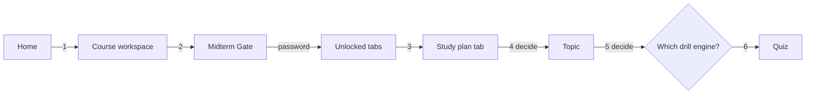
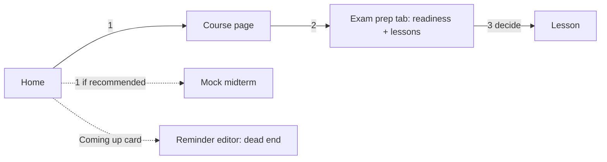
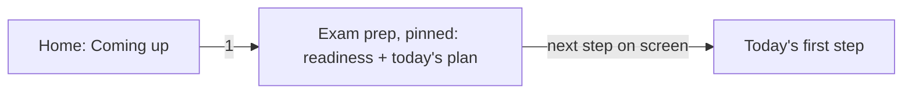
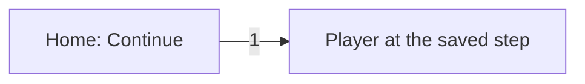
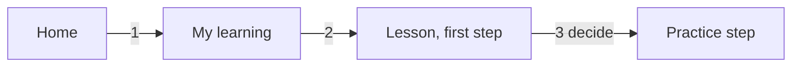
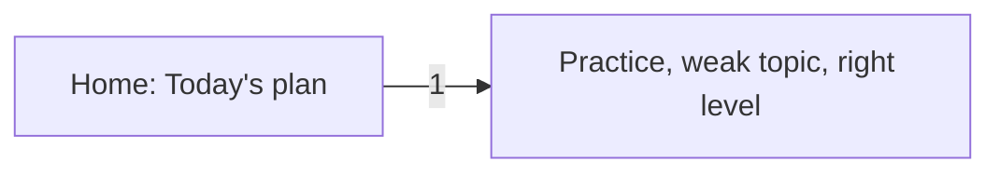
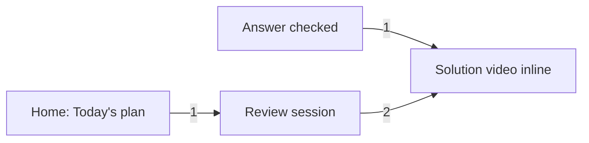
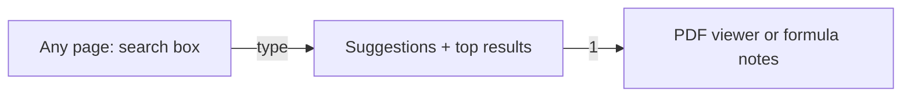

# Process map: the five jobs students come to the site for

Industrial-engineering view of the site: students are the orders, lessons, questions and videos are the
inventory, and every click is a process step. This file maps the click path for the five most common jobs,
on the live site (`main`), on the redesign as it stands (`redesign/udemy-style` at `7cb1855`), and the
target after the IE improvements on `improve/ie-principles`.

**How it was counted.** Clicks start on the home page, with no saved progress unless the job needs it
(Continue). Typing is not a click. A *page load* is a route change that swaps the main screen. A *decision
point* is a place where the student has to choose between options without the site telling them which.
Live-site counts come from its structure (ARCHITECTURE.md, Part A); redesign counts were walked in the
local preview.

## Summary

| Job | Live site: clicks / loads / decisions | Redesign now | Target |
|---|---|---|---|
| 1. Midterm in X days: what do I study? | 6 / 3 / 4 (+ a password) | 2 / 1 / 2 | **1 / 1 / 0** |
| 2. Continue where I left off | 4 / 2 / 3 (no memory of the last place) | 1 / 1 / 0 | 1 / 1 / 0 |
| 3. Practise one topic I'm weak in | 5 / 3 / 3 (no record of weak topics) | 3 / 1 / 1 | **1 / 1 / 0** |
| 4. Watch the solution to a question I got wrong | 6 / 3 / 3 (videos behind the vault) | 1 during the quiz, 3 later | 1 / 0 / 0, 2 later |
| 5. Find a specific PDF or formula | 4 / 2 / 3 (folder tree, one course at a time) | 1 + typing for PDFs; formulas not searchable | **1 + typing for both** |

The target for every job is: two clicks or fewer from the home page, and the next step always on screen.

---

## Job 1 · "I have a midterm in X days, what do I study?"

**Live site.** Course card → course workspace → badge glyph → Midterm Gate password page → type the
password → study-plan tab → choose a topic → choose one of several drill engines.

**Redesign now.** Home shows "Coming up" with the exam countdown and, when an exam is close, a
Recommended card "Sit the timed mock midterm". But clicking the Coming up card itself opens the reminder
editor (a dead end for this job), and the full exam plan sits behind the course page's Exam prep tab.

**Target.** The Coming up card *is* the way in: one click lands on that course's exam prep with the
readiness, the days left and a day-by-day plan. Editing the reminder moves to a pencil icon. On the course
page, Exam prep is pinned first whenever an exam is 21 days away or less.

## Job 2 · "Continue where I left off"

**Live site.** No memory of the last place: course → folder → document, or course → quiz section.

**Redesign now and target.** Home → Continue card → the exact step, video position or quiz question.
Already one click; the target only adds "Today's plan" next to it.

## Job 3 · "Practise one topic I'm weak in"

**Live site.** No record of weak topics: the student guesses, then course → quiz section → drill.

**Redesign now.** A Recommended "Strengthen" card links to the lesson's notes, then Next to the practice
(2–3 clicks); from My learning, a weak row in Topic mastery opens the lesson at its first step, not its
practice.

**Target.** "Today's plan" on Home and the weak rows in My learning go straight to the practice step,
starting at the right difficulty, and the review queue refills itself from weak topics.

## Job 4 · "Watch the solution to a question I got wrong"

**Live site.** Solve videos only existed inside the password vault's drills.

**Redesign now.** During the quiz the answer panel shows the video thumbnail: one click. Later, the
question is in the review queue: My learning → Review → answer → video (3).

**Target.** Same during the quiz. Later, from Home's Today's plan the review session opens directly (1),
and each reviewed answer shows the video in its "From the course" panel (2).

## Job 5 · "Find a specific PDF or formula"

**Live site.** Course → folder tree → folder → file, one course at a time; formulas were inside the
vault's lessons.

**Redesign now.** The search box suggests while typing and opens a PDF from its top results in one click,
but formulas are not in the search index, and the Resources tab still needs course → tab → folder → file.

**Target.** Formulas join the index (they open the lesson's key notes at that formula), so both jobs are
"type, one click".

---

## Layout by frequency (slotting)

Like putting fast-moving SKUs next to the dock, the most frequent jobs get the top of each screen.

| Screen | Top (every visit) | Middle (often) | One level down (rarely) |
|---|---|---|---|
| Home | Continue · Today's plan (review queue + next lesson) · Coming up | Recommended · course cards | — |
| Course landing | Continue / Start · Exam prep (pinned when an exam is ≤ 21 days away) | Course content | Videos, Resources (document tree), question bank |
| Player | The step · Next button · curriculum sidebar | Tabs: overview, notes, Ask AI, resources | — |
| Quiz | The question · answer · Check | Hint, confidence, flag | Read aloud, auto-read |
| My learning | Review queue · Reminders · exam readiness | Topic mastery, recommended | Stats, history |

## One template per page type

| Page type | Template (one component) | Replaces |
|---|---|---|
| Catalogue | `learn/pages/Home.tsx` | `HeroCourseSelector`, `Navbar`, `Footer` |
| Course landing | `learn/pages/CoursePage.tsx` | `CourseWorkspace`, `Engr213MidtermCompanion`, `InduMidtermPrep`, `Miae215ExamPaper`, `PracticeMidterm2026`, `TeacherMidtermPracticeSection`, `TopicVideosHub`, `Miae221YouTubeSection` |
| Player | `learn/pages/Player.tsx` | the vault's lesson, drill and video sub-pages |
| Quiz | `learn/quiz/QuizRunner.tsx` | `QuizEngine`, `QuizResults`, `DrillPicker`, vault `SkillQuiz`, vault drills |
| Dashboard | `learn/pages/MyLearning.tsx` | the vault's study plan |

The redesign already routes every course through these five; the old components are no longer imported
(see the lean audit, waste "Inventory").
